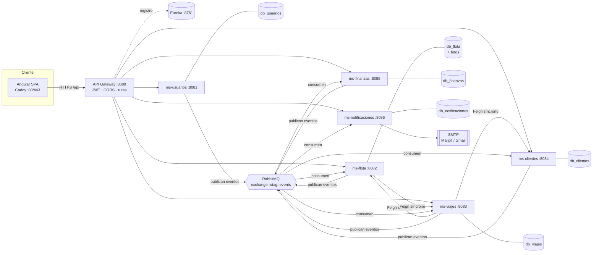
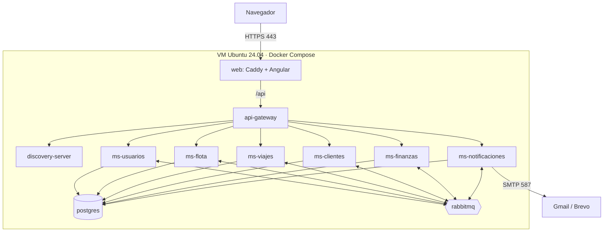
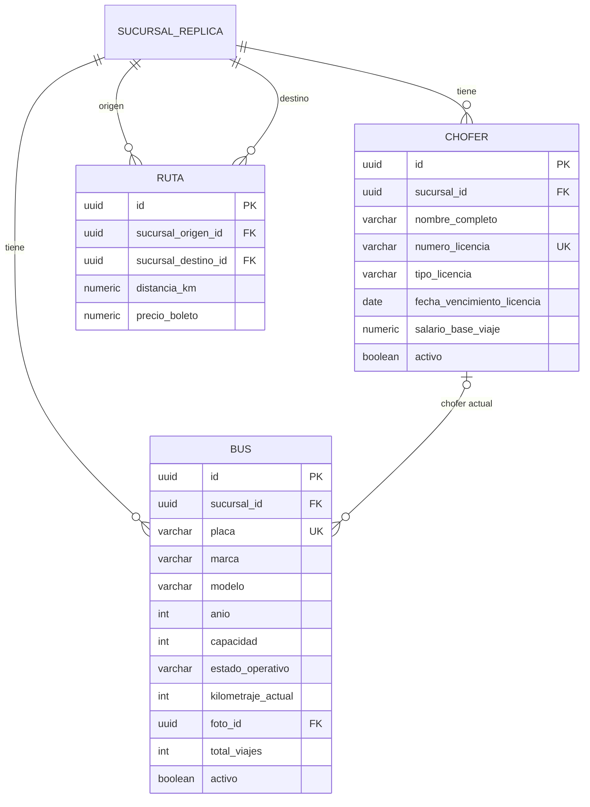
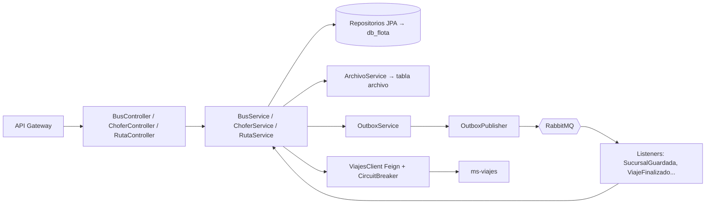

# GUÍA TÉCNICA — RutaGT

### Plataforma de transporte extraurbano · Proyecto 2 · Software Avanzado 2026

> **Para qué sirve este documento**
> 1. Explica **qué se construye**, **qué hace cada parte** y **por qué** se tomó cada decisión.
> 2. Indica **cómo ejecutar** el sistema: software necesario, variables de entorno, API keys (y cómo conseguirlas paso a paso).
> 3. Define **cómo documentar** el proyecto (manuales técnicos, diagramas, Swagger, Postman).
> 4. Obliga a usar los **mockups HTML** de `mockups/` como base del diseño del frontend.
>
> **Estado:** sistema terminado. Esta guía describe la implementación real; los desvíos respecto del plan inicial están en [PLAN.md → Estado de la implementación](PLAN.md#estado-de-la-implementación-actualizado-al-cerrar-el-proyecto). Documentación detallada: [`docs/`](docs/arquitectura.md).
>
> El *orden* de construcción está en [`PLAN.md`](PLAN.md). Esta guía es la referencia que se consulta durante y después de cada fase. **Mantenerla actualizada**: al terminar una fase, llenar su fila en la [sección 18](#18-registro-de-avance).

---

## Índice

1. [Resumen del sistema](#1-resumen-del-sistema)
2. [Stack tecnológico y justificación](#2-stack-tecnológico-y-justificación)
3. [Arquitectura](#3-arquitectura)
4. [Microservicios: qué hace cada uno](#4-microservicios-qué-hace-cada-uno)
5. [Comunicación entre microservicios](#5-comunicación-entre-microservicios)
6. [Decisiones de diseño y su justificación](#6-decisiones-de-diseño-y-su-justificación)
7. [Roles y permisos](#7-roles-y-permisos)
8. [Diseño del frontend: uso OBLIGATORIO de los mockups](#8-diseño-del-frontend-uso-obligatorio-de-los-mockups)
9. [Requisitos de software](#9-requisitos-de-software)
10. [Credenciales y API keys: cómo conseguirlas paso a paso](#10-credenciales-y-api-keys-cómo-conseguirlas-paso-a-paso)
11. [Variables de entorno](#11-variables-de-entorno)
12. [Cómo ejecutar el sistema](#12-cómo-ejecutar-el-sistema)
13. [Despliegue a producción](#13-despliegue-a-producción)
14. [Cómo documentar](#14-cómo-documentar)
15. [Pruebas](#15-pruebas)
16. [Solución de problemas](#16-solución-de-problemas)
17. [Glosario](#17-glosario)
18. [Registro de avance](#18-registro-de-avance)

---

## 1. Resumen del sistema

**RutaGT** es una plataforma web para una empresa de transporte extraurbano de Guatemala con varias sucursales. Permite:

| Área | Qué se puede hacer |
|---|---|
| **Flota** | Registrar buses (con foto) y choferes; rutas entre sucursales; avisos de licencias por vencer |
| **Viajes y ventas** | Programar viajes; vender boletos en línea (con selección de asientos) y en mostrador; registrar salidas y llegadas |
| **Clientes y alquileres** | Cuentas de cliente, cartera digital con recargas, historial; alquiler de buses para viajes privados |
| **Finanzas y administración** | Gastos de taller por categoría; combustible; depreciación por km; configuración; usuarios y sucursales |
| **Reportes** | Ingresos, gastos, ganancias, rutas más demandadas, taller, depreciación, mapa de rutas; todo exportable a PDF |

Usuarios: **Administrador del sistema**, **Administrador de sucursal**, **Cajero**, **Chofer** y **Cliente**.

---

## 2. Stack tecnológico y justificación

El enunciado deja el stack abierto pero exige justificarlo. Requisito del proyecto: **Java Spring Boot + Angular**.

| Capa | Tecnología | Versión | Por qué se eligió | Alternativa descartada y motivo |
|---|---|---|---|---|
| Lenguaje backend | **Java** | 21 LTS | Soporte a largo plazo, *records* para DTOs y eventos, *virtual threads* | Java 17: le faltan mejoras de rendimiento y de sintaxis |
| Framework | **Spring Boot** | 3.5.x | Es el estándar para microservicios en Java; integra seguridad, datos, mensajería y actuator | Spring Boot 4: muy reciente; menos ejemplos y librerías probadas para el plazo de entrega |
| Microservicios | **Spring Cloud** | 2025.0.x | Gateway, Eureka y OpenFeign compatibles con Boot 3.5 | Kubernetes *service discovery*: demasiada infraestructura para el alcance del curso |
| API Gateway | **Spring Cloud Gateway** | — | Un solo punto de entrada: valida JWT, CORS, enruta y agrega Swagger | Nginx solo: no entiende JWT ni descubre servicios |
| Descubrimiento | **Eureka** | — | Los servicios se encuentran por nombre (`lb://ms-flota`) y se pueden escalar | DNS de Docker: no permite balancear entre varias instancias ni ver su estado |
| Broker de eventos | **RabbitMQ** | 3.13 | DLQ nativo (*dead-letter exchange*), enrutamiento por *topic*, bajo consumo de RAM, consola web para demostrar los mensajes | Kafka: más pesado (requiere más memoria y configuración), su fuerte (*streaming* masivo/replay) no es necesario aquí |
| Comunicación síncrona | **OpenFeign + Resilience4j** | 2.2 | Cliente HTTP declarativo + *circuit breaker*, reintentos y *timeouts* | RestTemplate: en mantenimiento, sin resiliencia integrada |
| Base de datos | **PostgreSQL** | 16 | Transacciones ACID (dinero, asientos), `JSONB` para eventos, restricciones y *triggers* | MySQL: menos expresivo para *partial indexes*, `JSONB` y *triggers* |
| Migraciones | **Flyway** | — | Esquema versionado y reproducible en todos los entornos | `ddl-auto=update`: no es seguro en producción |
| Fotos | **PostgreSQL `bytea`** (tabla `archivo` de ms-flota) | 16 | Pocas fotos y pequeñas (≤ 5 MB); transaccionales con el registro y dentro del mismo respaldo; sin contenedor extra ([ADR-0009](docs/adr/0009-fotos-en-postgresql.md)) | MinIO: planificado al inicio, descartado (imagen no disponible en el entorno y +1 contenedor); disco: no sobrevive a recrear el contenedor; Cloudinary: depende de un tercero |
| Correo | **Spring Mail + Thymeleaf** | — | Plantillas HTML con la marca; SMTP estándar | SDK de un proveedor: amarra el código a ese proveedor |
| SMTP dev / prod | **Mailpit** / **Gmail SMTP** (o Brevo) | — | Mailpit captura correos localmente sin enviar nada real; Gmail es gratis y fácil de configurar | SendGrid: ya no tiene plan gratuito permanente |
| Documentación API | **springdoc-openapi** | 2.8.x | Genera Swagger UI automáticamente desde el código | Escribir OpenAPI a mano: se desactualiza |
| Pruebas | **JUnit 5, Mockito, Testcontainers 1.21, JaCoCo** | — | Integración con PostgreSQL y RabbitMQ **reales** en contenedores; los otros servicios se simulan con `@MockitoBean` sobre los clientes Feign; JaCoCo exige 60 % | H2 en memoria: no se comporta igual que PostgreSQL (triggers, JSONB); WireMock: más configuración para los mismos casos |
| Frontend | **Angular** | 21 | Requisito del proyecto; sin zone.js, componentes *standalone* y *signals* ([ADR-0012](docs/adr/0012-angular-sin-zone.md)) | — |
| UI | **SCSS propio desde los mockups + Angular CDK** | — | El diseño ya está definido en los mockups; CDK da diálogos y overlays accesibles sin imponer otro estilo | Angular Material/PrimeNG: traen su propio look y habría que pelear con sus estilos para igualar los mockups |
| Iconos | **Lucide** (`lucide`, importados uno por uno en `core/iconos.ts`) | — | Los mismos iconos que en los mockups | Emojis: no son accesibles ni consistentes |
| Mapas | **Leaflet + OpenStreetMap** | 1.9 | Sugerido por el enunciado; gratuito y **sin API key** | Google Maps: requiere tarjeta y API key |
| PDF | **jsPDF + jspdf-autotable** | — | Un solo servicio de exportación en el frontend para todos los reportes | JasperReports en cada microservicio: duplica plantillas en 5 servicios |
| Contenedores | **Docker + Docker Compose** | — | Levanta todo con un comando; mismo entorno en desarrollo y producción | Instalar cada servicio a mano: no es reproducible |
| HTTPS producción | **Caddy** | 2 | Certificados Let's Encrypt automáticos con 3 líneas de configuración | Nginx + certbot: más pasos manuales |

---

## 3. Arquitectura

### 3.1 Estilo arquitectónico

- **Microservicios** divididos por **contexto de negocio** (*bounded context*), uno por módulo del enunciado, más identidad y notificaciones.
- **Event-Driven Architecture**: los servicios se avisan los cambios mediante **eventos de dominio** publicados en RabbitMQ.
- **Database per service**: cada microservicio es dueño exclusivo de su base de datos. Nadie lee la base de otro.
- **Réplicas locales de lectura**: si un servicio necesita datos de otro (por ejemplo, la placa de un bus en ms-viajes), guarda una copia mínima que se actualiza con eventos.
- **Comunicación síncrona solo cuando se necesita una respuesta inmediata y consistente** (validar disponibilidad, debitar la cartera).

**Por qué:** el enunciado dice que la plataforma "se integrará con otros sistemas en el futuro" y debe "crecer y evolucionar de forma independiente por módulos". Separar por contexto y comunicar por eventos permite agregar consumidores nuevos (por ejemplo, un sistema contable) **sin tocar** los servicios existentes.

### 3.2 Diagrama general



### 3.3 Puertos y bases de datos

| Componente | Puerto | Base de datos | Swagger |
|---|---|---|---|
| frontend (Caddy) | 80 / 443 (`WEB_HTTP_PORT` / `WEB_HTTPS_PORT`), 4200 en desarrollo (`ng serve`) | — | — |
| api-gateway | 8080 | — | http://localhost:8080/swagger-ui.html (agregado) |
| discovery-server | 8761 | — | http://localhost:8761 (panel Eureka) |
| ms-usuarios | 8081 | `db_usuarios` | http://localhost:8081/swagger-ui.html |
| ms-flota | 8082 | `db_flota` | http://localhost:8082/swagger-ui.html |
| ms-viajes | 8083 | `db_viajes` | http://localhost:8083/swagger-ui.html |
| ms-clientes | 8084 | `db_clientes` | http://localhost:8084/swagger-ui.html |
| ms-finanzas | 8085 | `db_finanzas` | http://localhost:8085/swagger-ui.html |
| ms-notificaciones | 8086 | `db_notificaciones` | http://localhost:8086/swagger-ui.html |
| PostgreSQL | 5432 | las 6 anteriores | — |
| RabbitMQ | 5672 / 15672 | — | http://localhost:15672 (consola) |
| Mailpit | 1025 / 8025 | — | http://localhost:8025 (bandeja) |

> En Docker, los microservicios no publican puertos: su Swagger se consulta desde el agregado del gateway. Los puertos 8081–8086 sirven al ejecutar el backend en local (`scripts/backend-local.sh`).

### 3.4 Estructura interna de cada microservicio

```
gt.rutagt.<servicio>
├── api/              Controladores REST y DTOs (records). Solo traducen HTTP ⇄ casos de uso.
├── application/      Casos de uso (@Transactional). Aquí viven las reglas que coordinan.
├── domain/           Entidades, enums y reglas propias de cada entidad (p. ej. Bus.desactivar()).
├── infrastructure/
│   ├── persistence/  Repositorios Spring Data JPA.
│   ├── messaging/    Listeners de RabbitMQ y publicación vía outbox.
│   └── client/       Clientes Feign hacia otros servicios.
└── config/           Seguridad, colas, OpenAPI.
```

**Por qué esta estructura (capas + paquetes por responsabilidad):** es fácil de entender en un equipo pequeño, separa lo que cambia por motivos distintos (HTTP, negocio, base de datos, mensajería) y permite probar los casos de uso con *mocks* sin levantar Spring. Una arquitectura hexagonal completa (puertos/adaptadores en todos lados) añadiría mucho código ceremonial para un plazo de 3 semanas.

---

## 4. Microservicios: qué hace cada uno

| Servicio | Módulo del enunciado | Responsabilidad | Datos que posee | Réplicas que mantiene |
|---|---|---|---|---|
| **api-gateway** | — | Punto de entrada único, valida JWT, enruta, CORS, correlación, Swagger agregado | — | — |
| **discovery-server** | — | Registro de servicios (Eureka) | — | — |
| **ms-usuarios** | Finanzas y administración (usuarios) | Autenticación, emisión de JWT, usuarios y roles, perfiles, sucursales | usuario (con su perfil), sucursal, refresh_token | — |
| **ms-flota** | Flota | Buses, choferes, rutas, fotos, mapa de rutas, listados de buses/choferes | bus, chofer, ruta, archivo (fotos) | sucursales |
| **ms-viajes** | Viajes y ventas | Programación de viajes, salidas/llegadas, venta de boletos (en línea y mostrador), asientos, rutas más demandadas, ingresos por boletos | viaje, registro_salida, registro_llegada, compra, boleto, asiento_ocupado | rutas, buses, choferes, sucursales, enlace usuario↔cliente |
| **ms-clientes** | Clientes y alquileres | Clientes por NIT, cartera digital, alquileres privados, ingresos por alquiler | cliente, cartera, movimiento_cartera, alquiler | tarifas |
| **ms-finanzas** | Finanzas y administración | Configuración (depreciación, tarifas), categorías, gastos de taller, libro contable (ingresos/costos), depreciación, reportes financieros | parametro_version, categoria_gasto, gasto_taller(+línea), movimiento_financiero, depreciacion_viaje | buses, sucursales |
| **ms-notificaciones** | (detectado como módulo adicional) | Envío de correos por eventos, recordatorios de licencia, bitácora | correo, recordatorio_licencia | contactos, sucursales, licencias de choferes |

Manual técnico de cada uno (tablas, componentes, despliegue, endpoints, eventos y reglas): [`docs/servicios/`](docs/servicios).

**Por qué un servicio de notificaciones separado:** el enunciado pide correos "donde se considere oportuno". Si cada servicio enviara correos, habría 5 configuraciones SMTP y una caída del servidor de correo bloquearía compras. Separado y alimentado por eventos, **un correo que falla nunca rompe una venta**, y se reintenta solo.

**Por qué la venta de boletos vive en ms-viajes:** el bloqueo de asientos necesita la capacidad y el estado del viaje **en la misma transacción**. Separarlos obligaría a una transacción distribuida para algo que debe ser inmediato y consistente. Internamente se mantiene como un módulo (`ventas`) que reacciona a los eventos del viaje igual que lo haría un servicio externo, por lo que puede extraerse más adelante.

**Por qué el alquiler está repartido:** la solicitud, el precio y el pago son del cliente (ms-clientes, donde está la cartera); la ejecución del viaje (bus, chofer, salida, llegada) es igual a un viaje regular (ms-viajes). Al pagar, un evento crea el viaje privado, así no se duplica la lógica de operación.

---

## 5. Comunicación entre microservicios

### 5.1 Estilos usados

| Estilo | Tecnología | Cuándo se usa |
|---|---|---|
| **Asíncrono por eventos** (*publish/subscribe*) | RabbitMQ, exchange *topic* | Cuando algo **ya ocurrió** y otros deben enterarse (réplicas, finanzas, correos, propagación de eliminaciones) |
| **Síncrono request/response** | OpenFeign (HTTP) + Resilience4j | Cuando se necesita **una respuesta ahora** para decidir (¿hay saldo? ¿el bus está libre?) |

### 5.2 Topología en RabbitMQ

```
Exchange principal:   rutagt.events   (topic, durable)
Exchange de errores:  rutagt.dlx      (topic, durable)

Routing key:          <servicio-origen>.<entidad>.<evento>
                      ej.: viajes.viaje.finalizado

Cola por consumidor:  <servicio-consumidor>.<routing-key>
                      ej.: ms-finanzas.viajes.viaje.finalizado
                      argumentos: x-dead-letter-exchange = rutagt.dlx

Cola DLQ:             <cola>.dlq   (enlazada a rutagt.dlx)
```

**Por qué una cola por consumidor:** si ms-notificaciones está caído, sus mensajes se acumulan en su cola sin afectar a ms-finanzas. Cada servicio procesa a su ritmo.

### 5.3 Catálogo de eventos

Catálogo completo con el payload de cada evento: [`docs/eventos.md`](docs/eventos.md). Los consumidores de esta tabla se verificaron con los *bindings* reales de RabbitMQ.

| # | Evento | Productor | Consumidores | Acción del consumidor |
|---|---|---|---|---|
| 1 | `SucursalGuardada` | ms-usuarios | ms-flota, ms-viajes, ms-finanzas, ms-notificaciones | Actualizar réplica de sucursal |
| 2 | `UsuarioPersonalCreado` | ms-usuarios | ms-notificaciones | Correo de bienvenida con contraseña temporal; guardar contacto |
| 3 | `UsuarioClienteRegistrado` | ms-usuarios | ms-clientes, ms-notificaciones | Crear o **enlazar por NIT** el cliente y su cartera; correo de bienvenida |
| 4 | `PerfilActualizado` | ms-usuarios | ms-clientes, ms-notificaciones | Actualizar datos del cliente / contacto |
| 5 | `UsuarioEstadoCambiado` | ms-usuarios | ms-notificaciones | Activar/desactivar contacto |
| 6 | `BusGuardado` | ms-flota | ms-viajes, ms-finanzas | Réplica de bus |
| 7 | `ChoferGuardado` | ms-flota | ms-viajes, ms-notificaciones | Réplica de chofer; vencimiento de licencia y aviso inmediato si ya está dentro de un umbral |
| 8 | `RutaGuardada` | ms-flota | ms-viajes | Réplica de ruta (búsqueda pública, reportes) |
| 9 | `ViajeProgramado` | ms-viajes | ms-notificaciones | Correo al chofer |
| 10 | `ViajeIniciado` | ms-viajes | ms-flota | Bus `EN_RUTA` |
| 11 | `ViajeFinalizado` | ms-viajes | ms-flota, ms-finanzas, ms-clientes | Km y contadores; combustible, depreciación y salario; cerrar alquiler |
| 12 | `ViajeEliminado` | ms-viajes | ms-viajes (ventas), ms-clientes, ms-finanzas, ms-notificaciones | Anular compras y liberar asientos; reembolsar; reversar ingreso; avisar |
| 13 | `BoletosVendidos` | ms-viajes | ms-finanzas, ms-notificaciones | Registrar ingreso; correo de confirmación |
| 14 | `AlquilerAsignado` | ms-viajes | ms-clientes, ms-notificaciones | Guardar bus/chofer en el alquiler; correos al cliente y al chofer |
| 15 | `CarteraRecargada` | ms-clientes | ms-notificaciones | Correo de recarga |
| 16 | `CarteraReembolsada` | ms-clientes | ms-notificaciones | Correo de reembolso |
| 17 | `ClienteVinculado` | ms-clientes | ms-viajes | Enlace usuario ↔ cliente para el historial (incluye compras de mostrador previas) |
| 18 | `AlquilerSolicitado` | ms-clientes | ms-notificaciones | Acuse al cliente y aviso a los admins de la sucursal |
| 19 | `AlquilerPrecioConfirmado` | ms-clientes | ms-notificaciones | Avisar al cliente que ya puede pagar |
| 20 | `AlquilerRechazado` | ms-clientes | ms-notificaciones | Avisar al cliente |
| 21 | `AlquilerPagado` | ms-clientes | ms-viajes, ms-finanzas, ms-notificaciones | Crear viaje PRIVADO; ingreso; correo |
| 22 | `ConfiguracionActualizada` | ms-finanzas | ms-clientes | Tarifas para estimar alquileres |

### 5.4 Catálogo de llamadas síncronas y cumplimiento del 50 %

| # | Origen → destino | Endpoint | Por qué debe ser síncrona |
|---|---|---|---|
| S1 | ms-viajes → ms-flota | `/internal/buses/{id}/validar-asignacion` | Al programar hay que saber **ya** si el bus está activo |
| S2 | ms-viajes → ms-flota | `/internal/choferes/{id}/validar-asignacion` | Licencia vigente en la fecha del viaje |
| S3 | ms-viajes → ms-clientes | `/internal/cartera/debitos` | La compra solo se confirma si el débito se hizo |
| S4 | ms-viajes → ms-clientes | `/internal/cartera/debitos/{ref}` | Reconciliar pagos con *timeout* |
| S5 | ms-viajes → ms-clientes | `/internal/clientes/resolver` | La venta de mostrador necesita el `clienteId` |
| S6 | ms-flota → ms-viajes | `/internal/viajes/activos` | No desactivar un bus/chofer con viajes |
| S7 | ms-flota → ms-viajes | `/internal/viajes/existe` | No eliminar una ruta con viajes |

**Cálculo** (cada par productor→consumidor de un evento cuenta como una interacción):

| Tipo | Interacciones |
|---|---|
| Asíncronas (suma de consumidores de la tabla 5.3) | 4+1+2+2+1+2+2+1+1+1+3+4+2+2+1+1+1+1+1+1+3+1 = **38** |
| Síncronas (tabla 5.4) | **7** |
| **Porcentaje por eventos** | 38 / 45 = **≈ 84 %** ✅ (mínimo exigido: 50 %) |

Incluso contando cada *tipo de evento* una sola vez (22 eventos vs 7 llamadas), el porcentaje es 76 %.

### 5.5 Formato de un evento (sobre o *envelope*)

```json
{
  "eventId": "3f1c0d1e-8a0b-4c4e-9a52-1d4c1a7b2e10",
  "eventType": "ViajeFinalizado",
  "version": 1,
  "occurredAt": "2026-10-18T14:32:10-06:00",
  "source": "ms-viajes",
  "correlationId": "b7e2...",
  "payload": {
    "viajeId": "…", "tipo": "REGULAR", "sucursalId": "…", "busId": "…", "choferId": "…",
    "kmSalida": 184030, "kmFinal": 184232, "kmRecorridos": 202,
    "gastoCombustible": 1180.00, "salarioChofer": 250.00,
    "fechaLlegada": "2026-10-18T09:45:00-06:00", "alquilerId": null
  }
}
```

- `eventId`: identidad única → base de la **idempotencia**.
- `version`: permite evolucionar el contrato sin romper consumidores antiguos.
- `correlationId`: el mismo que entró por el gateway; permite seguir una operación en los logs de todos los servicios.

### 5.6 Garantías de entrega y recuperación de errores

| Problema | Mecanismo | Cómo funciona |
|---|---|---|
| El servicio guarda en BD pero RabbitMQ está caído → evento perdido | **Transactional Outbox** | El evento se inserta en `outbox_event` **en la misma transacción** que el cambio de negocio. Un *job* cada segundo publica los pendientes con *publisher confirms* y marca `published_at`. Si RabbitMQ no está, se reintenta en el siguiente ciclo. |
| El mismo evento llega dos veces (reintento del outbox, *redelivery* de RabbitMQ) | **Consumidor idempotente** | Antes de procesar se inserta `eventId` en `processed_event` dentro de la misma transacción. Si ya existe → se ignora y se confirma (*ack*). |
| El consumidor falla por un error temporal (BD ocupada, etc.) | **Reintentos con backoff** | Spring AMQP reintenta 3 veces (1 s, 2 s, 4 s). |
| El mensaje sigue fallando (dato inválido, *bug*) | **Dead Letter Queue** | Tras los reintentos se rechaza y va a `<cola>.dlq`. Se inspecciona en la consola de RabbitMQ y se puede reenviar tras corregir. Nunca bloquea la cola principal. |
| Otro servicio no responde en una llamada síncrona | **Timeout + Retry + Circuit Breaker** (Resilience4j) | *Timeout* de conexión 2 s y de lectura 3 s; hasta 3 intentos solo en errores de red; si falla el 50 % de las últimas 10 llamadas el circuito se abre 15 s y responde de inmediato con un 503 claro, sin colgar hilos. |
| Se reintenta un débito ya aplicado | **Idempotency-Key HTTP** | El débito usa la referencia de la compra como clave única; repetirlo devuelve el mismo resultado sin cobrar dos veces. |
| Dinero duplicado en finanzas | **UNIQUE(referencia_tipo, referencia_id, tipo)** en `movimiento_financiero` | Aunque fallara la tabla de idempotencia, la base de datos rechaza el duplicado. |
| Servicio caído en producción | `restart: unless-stopped` + *healthchecks* | Docker lo reinicia; Eureka deja de enviarle tráfico mientras no esté sano. |

---

## 6. Decisiones de diseño y su justificación

Cada decisión importante se registra también como ADR en `docs/adr/` (ver [§14.3](#143-registro-de-decisiones-adr)).

### 6.1 Réplicas locales en lugar de consultas cruzadas
**Decisión:** ms-viajes guarda una copia mínima de buses, choferes, rutas y sucursales que actualiza con eventos.
**Por qué:** mostrar la placa del bus en la lista de viajes no debe depender de que ms-flota esté encendido. Reduce llamadas síncronas (ayuda a cumplir el 50 % de eventos) y la latencia.
**Costo aceptado:** consistencia eventual de milisegundos. Para las validaciones críticas (programar un viaje) **sí** se consulta síncronamente a la fuente.

### 6.2 Seguridad con JWT validado en el gateway y en cada servicio
**Decisión:** ms-usuarios emite un JWT HS256 (60 min, configurable) + *refresh token* rotativo (7 días). El gateway lo valida y cada servicio también (*defense in depth*). Rutas `/internal/**` bloqueadas en el gateway.
**Por qué:** si alguien llega directo a un servicio saltándose el gateway, igual necesita un token válido. HS256 con secreto compartido es suficiente para un solo emisor y evita montar un servidor de identidad (Keycloak) que consumiría más memoria que todo el sistema.

### 6.3 Bloqueo de asientos con clave primaria compuesta
**Decisión:** tabla `asiento_ocupado` con `PRIMARY KEY (viaje_id, numero_asiento)`; los asientos se insertan **antes** del cobro.
**Por qué:** el enunciado pide bloqueo "inmediato y consistente, incluso ante compras concurrentes". La base de datos es el único árbitro que ve todas las transacciones, aunque haya varias instancias del servicio. Un `synchronized` en Java no sirve con más de una instancia; un bloqueo en Redis añadiría otra pieza de infraestructura.
**Saga de compensación:** si el débito falla, se borran los asientos (compensación). Si la respuesta no llega, un reconciliador consulta el resultado del débito por su referencia.

### 6.4 Eliminación de viajes con propagación de eventos
**Decisión:** borrar un viaje = marcarlo `eliminado` + publicar `ViajeEliminado` con la lista de compras. Cada servicio limpia lo suyo.
**Por qué:** así lo pide el enunciado y es el patrón correcto: ms-viajes no conoce (ni debe conocer) la cartera ni el libro contable. Si mañana existe un sistema de facturación, solo se suscribe al evento.
**Regla:** solo viajes `PROGRAMADO` (no iniciados ni completados).

### 6.5 Registros de salida y llegada inmutables
**Decisión:** sin endpoints de edición, entidades `@Immutable`, columnas `updatable=false` y *trigger* en PostgreSQL que rechaza `UPDATE`/`DELETE`; en la UI, modal con resumen y casilla "entiendo que no podrá modificarse".
**Por qué:** "no se pueden modificar ni eliminar **bajo ninguna circunstancia**". La protección en la base cubre incluso errores de programación o accesos directos.

### 6.6 Configuración versionada (depreciación por km)
**Decisión:** cada cambio inserta una nueva fila en `parametro_version` con `vigente_desde`. Al finalizar un viaje se guarda el **monto por km usado** (*snapshot*) en `depreciacion_viaje`.
**Por qué:** "el monto puede cambiarse en cualquier momento sin alterar los registros ya hechos". Guardar el snapshot hace que los reportes históricos nunca cambien y deja auditoría de quién cambió qué.

### 6.7 Clientes identificados por NIT y enlace automático
**Decisión:** `cliente.nit` es único. La venta de mostrador busca/crea el cliente por NIT (o usa el genérico `CF`). Cuando alguien se registra, el evento `UsuarioClienteRegistrado` enlaza su usuario al cliente existente con ese NIT.
**Por qué:** cumple "si ese cliente crea un usuario en el futuro, las ventas presenciales pasadas deben aparecer en su historial" sin migrar datos: el historial se consulta por `cliente_id`, que ya era el mismo.

### 6.8 Borrado lógico y reglas de administradores
**Decisión:** usuarios, buses, choferes y categorías con uso **solo se desactivan**. Antes de desactivar al último admin del sistema se bloquea la fila (`SELECT … FOR UPDATE`) para que dos desactivaciones simultáneas no dejen el sistema sin administrador.
**Por qué:** lo exige el enunciado y conserva la integridad de reportes históricos (un viaje antiguo sigue apuntando a su bus).

### 6.9 Fechas manuales con valor inicial "hoy"
**Decisión:** todo DTO de operación incluye su fecha (`fechaPago`, `fechaServicio`, `horaRealSalida`…). El frontend la inicializa con `hoy()`/`ahora()`; el backend usa la recibida y solo si viene vacía toma la actual.
**Por qué:** requisito explícito "para efectos de calificación". Permite simular escenarios (por ejemplo, ventas de meses anteriores para los reportes).
**Además:** el job de licencias se puede ejecutar con una fecha manual (`/recordatorios/ejecutar?fecha=`).

### 6.10 Fotos en PostgreSQL
**Decisión:** las fotos se suben a ms-flota (multipart), se validan (JPG/PNG/WebP, ≤ 5 MB), se guardan en la tabla `archivo` (`bytea`) de `db_flota` y se sirven por `GET /api/archivos/{id}` con caché HTTP de 30 días.
**Por qué:** son pocas y pequeñas (una por bus o chofer); quedan en la misma transacción que el registro y en el mismo respaldo; no hace falta otro contenedor en una VM de 8 GB. El plan inicial usaba MinIO, pero su imagen no estaba disponible en el entorno ([ADR-0009](docs/adr/0009-fotos-en-postgresql.md)). Si el volumen creciera, migrar a almacenamiento de objetos solo cambia `ArchivoService`.

### 6.11 Reportes calculados en cada servicio dueño de los datos + PDF en el frontend
**Decisión:** cada reporte lo genera el servicio que tiene los datos, con un DTO común `ReporteResponse`. El PDF se genera en Angular con jsPDF.
**Por qué:** evita un servicio de reportes que tendría que replicar *todo*. El DTO común permite **un solo** visor y **un solo** exportador a PDF para los 12 reportes, con el mismo formato visual de los mockups.

### 6.12 Correos siempre asíncronos
**Decisión:** ningún servicio envía correos directamente; publican eventos y ms-notificaciones envía.
**Por qué:** una compra no debe fallar ni tardar porque el SMTP esté lento. Si el correo falla, queda en la bitácora para reintentar.

### 6.13 Ingresos asignados a sucursal
- **Boletos:** sucursal de **origen** de la ruta (donde se presta el servicio y se vende).
- **Alquileres:** sucursal que el cliente elige para atenderlo.
- **Costos de viaje** (combustible, depreciación, salario): sucursal del viaje.
- **Taller:** sucursal del bus.
- **Recargas de cartera:** **no son ingreso** (es dinero del cliente en custodia); el ingreso ocurre cuando se usa para comprar.

---

## 7. Roles y permisos

| Funcionalidad | ADMIN_SISTEMA | ADMIN_SUCURSAL | CAJERO | CHOFER | CLIENTE |
|---|:-:|:-:|:-:|:-:|:-:|
| Sucursales (CRUD) | ✅ | 👁 | 👁 | | |
| Crear admin de sucursal | ✅ | | | | |
| Crear cajero / usuario chofer | ✅ | ✅ (su sucursal) | | | |
| Desactivar usuarios | ✅ | ✅ (su sucursal, no admins) | | | |
| Configuración (depreciación, tarifas) | ✅ | | | | |
| Categorías de gasto | ✅ | 👁 | | | |
| Buses y choferes | 👁 | ✅ (su sucursal) | | | |
| Rutas | 👁 | ✅ (origen = su sucursal) | | | |
| Programar / eliminar viajes | | ✅ | | | |
| Registrar salida / llegada | | ✅ | | ✅ (sus viajes) | |
| Venta en mostrador | | ✅ | ✅ | | |
| Alquileres: confirmar precio, asignar | | ✅ | | | |
| Gastos de taller | | ✅ | | | |
| Buscar viajes / comprar en línea | | | | | ✅ (búsqueda pública) |
| Cartera, historial, solicitar alquiler | | | | | ✅ |
| Perfil propio | ✅ | ✅ | ✅ | ✅ | ✅ |
| Reportes del sistema | ✅ | | | | |
| Reportes de sucursal | ✅ (cualquier sucursal) | ✅ (la suya) | | | |
| Bitácora de correos | ✅ | | | | |

✅ gestiona · 👁 solo consulta

**Cómo se aplica:** el JWT lleva `rol` y `sucursalId`. Los controladores usan `@PreAuthorize("hasRole('ADMIN_SUCURSAL')")` y los casos de uso **siempre** toman la sucursal del token, nunca del cuerpo de la petición (así un admin no puede operar otra sucursal manipulando el JSON).

---

## 8. Diseño del frontend: uso OBLIGATORIO de los mockups

> ⚠️ **Regla:** el frontend Angular **debe construirse a partir de los mockups HTML** de la carpeta [`mockups/`](mockups/index.html). No se inventan colores, tamaños ni componentes nuevos: si falta algo, se diseña primero en el mockup siguiendo el mismo sistema y luego se implementa.
>
> El enunciado penaliza una interfaz difícil de usar; los mockups ya aplican reglas de usabilidad y accesibilidad (contraste, etiquetas visibles, confirmaciones, estados vacíos, objetivos táctiles de 44 px).

### 8.1 Cómo ver los mockups

```bash
cd mockups && python3 -m http.server 5500
# abrir http://localhost:5500  → índice con la guía de estilo y todas las pantallas
```

(Abrirlos con doble clic también funciona, pero los mapas y algunos estilos cargan mejor con el servidor.)

### 8.2 Paleta de colores

| Token | Hex | Uso |
|---|---|---|
| `--brand-900` | `#0B2545` | Sidebar, barra del portal, filas de grupo en reportes |
| `--brand-800` | `#13315C` | Fila de total en reportes, degradados |
| `--brand-700` | `#1A4478` | *Hover* de botón primario, ítem activo del menú |
| `--brand-600` | `#1D5BA6` | **Color primario**: botones, enlaces, foco |
| `--brand-100` | `#DCE8F7` | Anillo de foco de inputs |
| `--brand-50` | `#EEF4FB` | *Hover* de filas, subtotales |
| `--accent-500` | `#E8971E` | **Solo** CTA de compra/pago y asiento seleccionado |
| `--accent-600` | `#C77A0A` | *Hover* del CTA |
| `--gray-900` | `#1E2329` | Texto principal |
| `--gray-600` | `#545D69` | Texto secundario (contraste 6.4:1) |
| `--gray-200` | `#E3E5E8` | Bordes |
| `--gray-50` | `#F7F7F5` | Fondo de la aplicación |
| `--success-500` / `-100` / `-700` | `#1F9D55` / `#DDF3E6` / `#146C3A` | Activo, disponible, pagado, completado |
| `--warning-500` / `-100` / `-700` | `#D97706` / `#FDEBD0` / `#8A4B00` | Por vencer, pendiente, en taller |
| `--danger-500` / `-100` / `-700` | `#D23B3B` / `#FBE1E1` / `#9B1C1C` | Inactivo, error, acción irreversible |
| `--info-500` / `-100` / `-700` | `#3A78C4` / `#DCE8F7` / `#1A4478` | En ruta, programado, información |

**Justificación:** el azul noche transmite confianza e institucionalidad (se maneja dinero y seguridad vial); el amarillo de acento evoca las camionetas guatemaltecas y, al reservarse solo para pagar, guía la vista hacia la acción principal. Todos los pares texto/fondo cumplen contraste WCAG AA (≥ 4.5:1).

### 8.3 Tipografía

| Uso | Fuente | Peso / tamaño |
|---|---|---|
| Interfaz general | **Fira Sans** | 400/500/600/700; cuerpo 16 px, mínimo 12 px |
| Placas, códigos, montos en tablas | **Fira Code** (con `tabular-nums`) | 500/600 |

Escala: 12 · 14 · 16 · 18 · 20 · 24 · 30 · 36 px. Espaciado en múltiplos de 4 px (`--sp-1` … `--sp-16`). Radios 6/10/14 px.

**Por qué Fira:** fue diseñada para pantallas y datos; su variante monoespaciada alinea columnas de montos y placas.

### 8.4 Cómo trasladar los mockups a Angular

1. **Tokens y estilos globales:** copiar `mockups/assets/styles.css` → `frontend/src/styles/_tokens.scss` (bloque `TOKENS`) y `_components.scss` (el resto). Las clases (`.btn`, `.card`, `.badge`, `.table`…) se usan **tal cual** en las plantillas Angular.
2. **Componentes y servicios compartidos:** encapsulan el HTML y el comportamiento repetidos de los mockups. Las clases de maquetación (`.page-head`, `.card`, `.kpi`, `.filters`, `.table`, `.tabs`, `.plate`…) se usan directamente en las plantillas.

| Patrón en el mockup | Implementación en Angular |
|---|---|
| `.sidebar` + `NAV` de `app.js` | `layout/panel.ts` + `layout/navegacion.ts` (mismo menú por rol) |
| `.portal-nav` | `layout/portal.ts` |
| `.overlay > .modal` | `shared/dialogo.ts` (`DialogoService.confirmar`, con casilla "entiendo…"; Angular CDK `Dialog` + `cdkTrapFocus`) |
| `.badge--*` | `shared/estado.ts` (enum → color + texto) |
| `.seats` (`initSeats()` en `app.js`) | `shared/mapa-asientos.ts` |
| `.field` + `.error` | `shared/campo-error.ts` + `aplicarErroresServidor()` de `core/util.ts` (errores del servidor bajo cada campo) |
| `input[data-today]` | Valor inicial `hoy()` / `ahora()` de `core/util.ts` |
| `.empty` | `shared/vacio.ts` |
| `.alert--*` y avisos | `core/toast.ts` |
| Paginación | `shared/paginador.ts` |
| Tabla de reporte con `.group`/`.subtotal`/`.total` | `shared/tabla-reporte.ts` + `features/reportes/reporte.ts` (definiciones en `reportes/definiciones.ts`) |
| Mapas (Leaflet) | `shared/mapa.ts` |
| Íconos `data-lucide` | `shared/icono.ts` + `core/iconos.ts` |
| Botón "Exportar PDF" | `core/pdf.ts` (jsPDF + autotable) y `core/exportar.ts` |

3. **Pantallas** (una ruta por mockup, todas con carga diferida en `app.routes.ts`):

| Mockup | Ruta Angular | Rol |
|---|---|---|
| `login.html` | `/login`, `/registro`, `/cambiar-password` | público |
| `cliente-viajes.html` | `/portal/viajes` | público / CLIENTE |
| `cliente-asientos.html` | `/portal/viajes/:id` | público (pide sesión al pagar) / CLIENTE |
| `cliente-cuenta.html` | `/portal/cuenta` (pestañas historial, cartera y perfil) | CLIENTE |
| `cliente-alquiler.html` | `/portal/alquiler` | público (muestra el formulario; cotizar y solicitar requieren sesión de cliente) / CLIENTE |
| `sucursal-dashboard.html` | `/sucursal` | ADMIN_SUCURSAL, CAJERO |
| `sucursal-buses.html` | `/sucursal/buses` | ADMIN_SUCURSAL |
| `sucursal-choferes.html` | `/sucursal/choferes` | ADMIN_SUCURSAL |
| `sucursal-rutas-viajes.html` | `/sucursal/viajes` (pestañas viajes y rutas) | ADMIN_SUCURSAL |
| `sucursal-operacion.html` | `/sucursal/operacion` | ADMIN_SUCURSAL, CHOFER |
| `sucursal-mostrador.html` | `/sucursal/mostrador` | ADMIN_SUCURSAL, CAJERO |
| `sucursal-alquileres.html` | `/sucursal/alquileres` | ADMIN_SUCURSAL |
| `sucursal-taller.html` | `/sucursal/taller` | ADMIN_SUCURSAL |
| `admin-dashboard.html` | `/admin` | ADMIN_SISTEMA |
| `admin-sucursales-usuarios.html` | `/admin/sucursales`, `/admin/usuarios`, `/sucursal/personal` | ADMIN_SISTEMA / ADMIN_SUCURSAL |
| `admin-configuracion.html` | `/admin/configuracion`, `/admin/correos` | ADMIN_SISTEMA |
| `reporte-financiero.html` | `/admin/reportes/*`, `/sucursal/reportes/*` | según reporte |
| `reporte-mapa-rutas.html` | `/admin/mapa` | ADMIN_SISTEMA |
| — | `/sucursal/perfil`, `/admin/perfil` | personal |

### 8.5 Reglas de UX que no se negocian

1. Toda fecha de operación inicia con la fecha actual y es editable.
2. Etiqueta visible en cada campo; errores debajo del campo (no solo arriba).
3. Acciones irreversibles (salida/llegada, pagar, eliminar viaje, desactivar) → modal de confirmación con el resumen de datos.
4. Listados/reportes: filtros arriba, "Exportar PDF" siempre visible, estado vacío amigable, paginación.
5. Botones con estado de carga; *toast* verde al guardar; mensaje claro al fallar.
6. Contraste ≥ 4.5:1, foco visible, objetivos ≥ 44 px, iconos SVG con `aria-label` cuando no tienen texto.
7. *Responsive*: probar 375, 768, 1024 y 1440 px. En móvil el sidebar se vuelve menú hamburguesa.
8. Montos con `Q` y 2 decimales (`CurrencyPipe` con `'GTQ'` y símbolo `Q`), alineados a la derecha.
9. Estados siempre con texto + color (nunca solo color).

---

## 9. Requisitos de software

| Software | Versión | Para qué | Instalación (Debian/Ubuntu) |
|---|---|---|---|
| JDK (Temurin) | 21 | Compilar y ejecutar los servicios | `sudo apt install openjdk-21-jdk` o [adoptium.net](https://adoptium.net) |
| Maven | 3.9+ (opcional) | Construir el backend | No hace falta: el repositorio trae `backend/mvnw` (Maven 3.9.16) |
| Node.js | 20.19+ o 22 LTS | Construir el frontend | [nodejs.org](https://nodejs.org) o `nvm install 22` |
| Angular CLI | 21 | Generar y servir Angular | Viene en `devDependencies`: `npx ng …` o `npm --prefix frontend start` |
| Python | 3.10+ | `scripts/seed.py` y `scripts/generar_postman.py` (solo biblioteca estándar) | `sudo apt install python3` |
| Docker Engine + Compose v2 | 24+ | Infraestructura y despliegue | [docs.docker.com/engine/install](https://docs.docker.com/engine/install/) y `sudo usermod -aG docker $USER` |
| Git | 2.4+ | Control de versiones | `sudo apt install git` |
| IDE | — | IntelliJ IDEA (backend), VS Code (frontend) | — |
| Postman (o Newman) | — | Probar API | [postman.com/downloads](https://www.postman.com/downloads/) · `npx newman` (sin instalar) |

**Hardware recomendado en desarrollo:** 16 GB de RAM (son 8 JVMs + PostgreSQL + RabbitMQ). Con 8 GB, levantar solo los servicios en los que se trabaja.

---

## 10. Credenciales y API keys: cómo conseguirlas paso a paso

| Credencial | ¿Obligatoria? | Dónde se usa | Costo |
|---|---|---|---|
| `JWT_SECRET` | Sí | ms-usuarios (firma) y todos los servicios (validación) | Gratis (se genera) |
| Usuario/clave de PostgreSQL y RabbitMQ | Sí | Infraestructura | Gratis (se inventan) |
| Contraseña de aplicación de Gmail (SMTP) | Solo en producción | ms-notificaciones | Gratis |
| Clave SMTP de Brevo | Alternativa a Gmail | ms-notificaciones | Gratis (300 correos/día) |
| Token de DuckDNS | Solo en producción | Dominio gratuito para HTTPS | Gratis |
| Cuenta en la nube (VM) | Solo en producción | Servidor | Gratis con créditos de estudiante |
| **Leaflet / OpenStreetMap** | **No requiere API key** | Mapas | Gratis |

### 10.1 Generar `JWT_SECRET`

Debe tener al menos 256 bits (32 bytes) para HS256.

```bash
openssl rand -base64 48
```

Copiar el resultado en `.env` → `JWT_SECRET=...`. **Nunca** subirlo a Git. Usar uno distinto en producción.

### 10.2 Contraseñas de infraestructura

Se inventan; generarlas así:

```bash
openssl rand -base64 18   # una por cada: DB_PASSWORD, RABBITMQ_PASSWORD, BOOTSTRAP_ADMIN_PASSWORD
```

Evitar comillas, `$` y espacios en estas contraseñas: el `.env` también se carga con `source` en `scripts/backend-local.sh`.

### 10.3 Correo en desarrollo: Mailpit (sin API key)

No hay que hacer nada: `docker-compose.infra.yml` levanta Mailpit. Configuración en `.env`:

```env
MAIL_HOST=localhost
MAIL_PORT=1025
MAIL_USERNAME=
MAIL_PASSWORD=
MAIL_SMTP_AUTH=false
MAIL_STARTTLS=false
```

Todos los correos se ven en **http://localhost:8025**. No sale nada a internet, así que se puede probar con correos inventados.

### 10.4 Correo en producción: contraseña de aplicación de Gmail (paso a paso)

> Usar una cuenta **personal** de Gmail (`@gmail.com`). Las cuentas institucionales (como `@cunoc.edu.gt`) suelen tener deshabilitadas las contraseñas de aplicación por el administrador. Se recomienda crear una cuenta nueva solo para el proyecto, por ejemplo `rutagt.notificaciones@gmail.com`.

1. Iniciar sesión en la cuenta de Gmail en el navegador.
2. Ir a **https://myaccount.google.com/security**.
3. En **"Cómo inicias sesión en Google"**, abrir **"Verificación en 2 pasos"** y **activarla** (pide un número de teléfono y un código SMS). *Sin esto no aparece la opción de contraseñas de aplicación.*
4. Ir a **https://myaccount.google.com/apppasswords** (o buscar "Contraseñas de aplicaciones" en la barra de búsqueda de la cuenta).
5. Escribir un nombre para la app, por ejemplo `RutaGT`, y pulsar **Crear**.
6. Google muestra una contraseña de **16 letras** (formato `abcd efgh ijkl mnop`). **Copiarla ahora**: no se vuelve a mostrar.
7. Configurar `.env` de producción (los espacios de la contraseña se pueden quitar):

```env
MAIL_HOST=smtp.gmail.com
MAIL_PORT=587
MAIL_USERNAME=rutagt.notificaciones@gmail.com
MAIL_PASSWORD=abcdefghijklmnop
MAIL_FROM="RutaGT <rutagt.notificaciones@gmail.com>"
MAIL_SMTP_AUTH=true
MAIL_STARTTLS=true
MAIL_HOST_EN_DOCKER=smtp.gmail.com   # el que usan los contenedores de docker-compose.yml
```

8. Probar: crear un usuario de personal con un correo real y revisar la bitácora en **Admin → Correos y licencias**.

Límites: unos 500 correos/día, suficiente para el proyecto. Si se revoca la contraseña (en la misma página), hay que generar otra.

### 10.5 Alternativa: Brevo (antes Sendinblue)

Útil si Gmail bloquea los envíos desde la IP del servidor.

1. Crear una cuenta gratuita en **https://www.brevo.com** (plan Free: 300 correos/día).
2. Verificar el correo de registro y completar el perfil.
3. Ir a **Senders, Domains & Dedicated IPs → Senders → Add a sender** y agregar el correo remitente (ej. tu Gmail). Confirmar el correo de verificación que llega.
4. Ir a **SMTP & API** (menú del perfil, arriba a la derecha) → pestaña **SMTP** → **Generate a new SMTP key** → nombre `RutaGT` → copiar la clave.
5. En esa misma página aparece el **Login** SMTP (un correo del tipo `xxxx@smtp-brevo.com`).
6. `.env`:

```env
MAIL_HOST=smtp-relay.brevo.com
MAIL_PORT=587
MAIL_USERNAME=<Login SMTP mostrado por Brevo>
MAIL_PASSWORD=<SMTP key generada>
MAIL_FROM="RutaGT <correo-remitente-verificado@gmail.com>"
MAIL_SMTP_AUTH=true
MAIL_STARTTLS=true
MAIL_HOST_EN_DOCKER=smtp-relay.brevo.com
```

### 10.6 Dominio gratuito con DuckDNS (producción)

1. Entrar a **https://www.duckdns.org** e iniciar sesión con GitHub o Google.
2. En **sub domain** escribir el nombre deseado (ej. `rutagt`) → **add domain**. Queda `rutagt.duckdns.org`.
3. En **current ip** poner la **IP pública de la VM** → **update ip**.
4. Copiar el **token** que aparece arriba de la página (se usa solo si se quiere actualizar la IP automáticamente).
5. `.env` de producción: `DOMAIN=rutagt.duckdns.org`.

### 10.7 Servidor en la nube (producción)

| Opción | Requisitos | Recomendación |
|---|---|---|
| **Azure for Students** | Correo universitario (`@cunoc.edu.gt`), **sin tarjeta**, USD 100 de crédito | ✅ Recomendada. VM **B2ms (2 vCPU, 8 GB)** con Ubuntu 24.04 |
| GitHub Student Developer Pack → DigitalOcean | Verificación de estudiante en GitHub | Droplet de 8 GB con el crédito del pack |
| Oracle Cloud *Always Free* | Tarjeta para verificación (no cobra) | VM Ampere ARM 4 OCPU / 24 GB gratis. Todas las imágenes usadas tienen versión ARM64 |

Pasos para Azure for Students:
1. Ir a **https://azure.microsoft.com/free/students** → **Activar ahora** → iniciar sesión con el correo universitario y verificarlo.
2. En el portal: **Máquinas virtuales → Crear** → imagen **Ubuntu Server 24.04 LTS**, tamaño **B2ms**, autenticación **Clave pública SSH** (descargar el `.pem`).
3. **Puertos de entrada:** permitir **22 (SSH), 80 (HTTP), 443 (HTTPS)**. No abrir 5432, 5672, 15672, 8080 ni 8081-8086 (el compose ya los deja solo en `127.0.0.1` o sin publicar).
4. Crear y copiar la **IP pública**. Conectarse: `ssh -i clave.pem azureuser@<IP>`.

---

## 11. Variables de entorno

### 11.1 Archivo `.env.example` (copiar a `.env` y llenar)

Los valores con espacios van entre comillas para que el archivo también se pueda cargar con `source` (lo hace `scripts/backend-local.sh`). En `docker-compose.yml`, `DB_HOST`, `RABBITMQ_HOST`, `EUREKA_URL` y `MAIL_HOST` se sobrescriben con los nombres de los contenedores.

```env
# =====================================================================
#  RutaGT — Variables de entorno
#  Copiar a .env y completar:  cp .env.example .env
#  Cómo obtener cada credencial: ver GUIA.md, sección 10.
# =====================================================================

# ───────── General ─────────
SPRING_PROFILES_ACTIVE=dev
TZ=America/Guatemala
# Origen permitido por CORS y usado en los enlaces de los correos (prod: https://<tu-dominio>)
FRONTEND_URL=http://localhost:4200

# ───────── PostgreSQL ─────────
# Fuera de Docker: localhost. Dentro de docker-compose se sobrescribe a "postgres".
DB_HOST=localhost
DB_PORT=5432
DB_USER=rutagt
DB_PASSWORD=rutagt_dev_2026

# ───────── RabbitMQ ─────────
RABBITMQ_HOST=localhost
RABBITMQ_PORT=5672
RABBITMQ_USER=rutagt
RABBITMQ_PASSWORD=rutagt_dev_2026

# ───────── Eureka ─────────
EUREKA_URL=http://localhost:8761/eureka

# ───────── Seguridad (JWT) ─────────
# Generar con:  openssl rand -base64 48     (mínimo 32 bytes; usar uno distinto en producción)
JWT_SECRET=cambia-esto-por-el-resultado-de-openssl-rand-base64-48-xxxxxxxx
JWT_ACCESS_MINUTES=60
JWT_REFRESH_DAYS=7

# ───────── Administrador inicial (se crea si no existe ninguno) ─────────
BOOTSTRAP_ADMIN_EMAIL=admin@rutagt.com
BOOTSTRAP_ADMIN_PASSWORD=Admin12345
BOOTSTRAP_ADMIN_NOMBRE="Administrador del Sistema"

# ───────── Correo ─────────
# Desarrollo: Mailpit (captura los correos en http://localhost:8025, no envía nada real).
# Producción con Gmail: MAIL_HOST=smtp.gmail.com, MAIL_PORT=587, MAIL_SMTP_AUTH=true, MAIL_STARTTLS=true
MAIL_HOST=localhost
# Servidor SMTP visto desde los contenedores (docker-compose.yml): mailpit en demostración local,
# smtp.gmail.com (u otro) en producción.
MAIL_HOST_EN_DOCKER=mailpit
MAIL_PORT=1025
MAIL_USERNAME=
MAIL_PASSWORD=
MAIL_FROM="RutaGT <no-reply@rutagt.local>"
MAIL_SMTP_AUTH=false
MAIL_STARTTLS=false
# Recordatorios de licencia: todos los días a las 07:00 (formato cron de Spring: seg min hora día mes díaSemana)
NOTIF_CRON="0 0 7 * * *"

# ───────── Producción ─────────
# Dominio público (Caddy obtiene el certificado HTTPS automáticamente con Let's Encrypt).
# En local usar DOMAIN=":80" (solo HTTP, acepta cualquier host).
DOMAIN=localhost
# Puertos del host para Caddy (cambiarlos si el 80/443 ya están ocupados, p. ej. 8088/8443)
WEB_HTTP_PORT=80
WEB_HTTPS_PORT=443
JAVA_OPTS="-Xms96m -Xmx256m -XX:+UseSerialGC -XX:TieredStopAtLevel=1"
```

### 11.2 Qué variables usa cada componente

| Variable | gateway | discovery | usuarios | flota | viajes | clientes | finanzas | notificaciones | web |
|---|:-:|:-:|:-:|:-:|:-:|:-:|:-:|:-:|:-:|
| `DB_*` | | | ✅ | ✅ | ✅ | ✅ | ✅ | ✅ | |
| `RABBITMQ_*` | | | ✅ | ✅ | ✅ | ✅ | ✅ | ✅ | |
| `EUREKA_URL` | ✅ | | ✅ | ✅ | ✅ | ✅ | ✅ | ✅ | |
| `JWT_SECRET` | ✅ | | ✅ | ✅ | ✅ | ✅ | ✅ | ✅ | |
| `JWT_ACCESS_MINUTES`, `JWT_REFRESH_DAYS` | | | ✅ | | | | | | |
| `BOOTSTRAP_ADMIN_*` | | | ✅ | | | | | | |
| `MAIL_*`, `NOTIF_CRON` | | | | | | | | ✅ | |
| `MAIL_HOST_EN_DOCKER` | | | | | | | | ✅ (solo en Docker) | |
| `FRONTEND_URL` | ✅ | | | | | | | ✅ (enlaces en correos) | |
| `DOMAIN`, `WEB_HTTP_PORT`, `WEB_HTTPS_PORT` | | | | | | | | | ✅ (Caddy) |
| `TZ`, `JAVA_OPTS` | ✅ | ✅ | ✅ | ✅ | ✅ | ✅ | ✅ | ✅ | |

### 11.3 Cómo las lee Spring

Extracto simplificado de `backend/ms-flota/src/main/resources/application.yml`:

```yaml
server:
  port: 8082
spring:
  application.name: ms-flota
  datasource:
    url: jdbc:postgresql://${DB_HOST:localhost}:${DB_PORT:5432}/db_flota
    username: ${DB_USER}
    password: ${DB_PASSWORD}
  jpa:
    open-in-view: false
    hibernate.ddl-auto: validate          # el esquema lo maneja Flyway
    properties.hibernate.jdbc.time_zone: America/Guatemala
  rabbitmq:
    host: ${RABBITMQ_HOST:localhost}
    port: ${RABBITMQ_PORT:5672}
    username: ${RABBITMQ_USER}
    password: ${RABBITMQ_PASSWORD}
    publisher-confirm-type: correlated
    listener.simple:
      acknowledge-mode: auto
      default-requeue-rejected: false     # tras reintentos → DLQ
      retry:
        enabled: true
        max-attempts: 3
        initial-interval: 1000
        multiplier: 2
  servlet.multipart.max-file-size: 5MB
eureka.client.service-url.defaultZone: ${EUREKA_URL:http://localhost:8761/eureka}
rutagt:
  jwt.secret: ${JWT_SECRET}
spring.cloud.openfeign.client.config.default: { connect-timeout: 2000, read-timeout: 3000 }
resilience4j:
  circuitbreaker.configs.default: { sliding-window-size: 10, failure-rate-threshold: 50, wait-duration-in-open-state: 15s }
  retry.configs.default: { max-attempts: 3, wait-duration: 300ms }
management.endpoints.web.exposure.include: health,info
springdoc.swagger-ui.path: /swagger-ui.html
```

En IntelliJ, para ejecutar un servicio fuera de Docker, cargar el `.env` con el plugin **EnvFile** o en *Run Configuration → Environment variables*. Desde la terminal, `scripts/backend-local.sh` lo hace solo.

---

## 12. Cómo ejecutar el sistema

### 12.1 Opción A — Todo con Docker (lo más simple)

```bash
git clone <url-del-repositorio> rutagt && cd rutagt
cp .env.example .env                            # llenar valores (sección 11); como mínimo JWT_SECRET
docker compose --profile dev up -d --build --wait   # la primera vez tarda varios minutos; --profile dev agrega Mailpit
docker compose ps                               # los 11 contenedores deben quedar "healthy"
python3 scripts/seed.py                         # datos de prueba (opcional, ~1-2 min)
```

Abrir **http://localhost** e ingresar con `BOOTSTRAP_ADMIN_EMAIL` / `BOOTSTRAP_ADMIN_PASSWORD` o con los usuarios de §12.4.

> Si el puerto 80 de tu máquina ya está ocupado (por ejemplo, por Apache), poner en `.env` `WEB_HTTP_PORT=8088` y `DOMAIN=":80"` y abrir http://localhost:8088.

### 12.2 Opción B — Desarrollo (infraestructura en Docker, código local)

```bash
# 1. Infraestructura (PostgreSQL, RabbitMQ, Mailpit)
docker compose -f docker-compose.infra.yml --env-file .env up -d

# 2. Backend: compila e inicia los 8 servicios en segundo plano, en orden (logs en logs/)
cd backend && ./mvnw -q install -DskipTests && cd ..
scripts/backend-local.sh iniciar        # también: estado | detener

# 3. Frontend (proxy /api → http://localhost:8080)
npm --prefix frontend install
npm --prefix frontend start             # http://localhost:4200
```

Para trabajar en un solo servicio desde el IDE: `scripts/backend-local.sh iniciar`, detener ese servicio y ejecutarlo desde IntelliJ con el `.env`.

**Orden de arranque y por qué:** primero la infraestructura (los servicios fallan sin BD/broker), luego Eureka (los demás se registran en él) y después los microservicios y el gateway, en cualquier orden: si un consumidor arranca después, sus mensajes lo esperan en la cola.

### 12.3 URLs útiles

| Qué | URL |
|---|---|
| Aplicación (dev) | http://localhost:4200 |
| Aplicación (Docker) | http://localhost (o `:WEB_HTTP_PORT`) |
| API Gateway + Swagger agregado (98 operaciones) | http://localhost:8080/swagger-ui.html |
| Eureka (solo en desarrollo local) | http://localhost:8761 |
| RabbitMQ (colas, DLQ, mensajes) | http://localhost:15672 |
| Bandeja de correos (Mailpit) | http://localhost:8025 |

### 12.4 Usuarios de prueba (después de `python3 scripts/seed.py`)

Todos con la contraseña **`Rutagt2026!`** (configurable con `--password`), salvo el administrador del sistema.

| Rol | Correo |
|---|---|
| Admin del sistema | valor de `BOOTSTRAP_ADMIN_EMAIL` (`admin@rutagt.com`) con `BOOTSTRAP_ADMIN_PASSWORD` |
| Admin del sistema (auditor) | `auditor@rutagt.com` |
| Admins de sucursal | `admin.gua@rutagt.com` (Guatemala), `admin.xela@rutagt.com` (Quetzaltenango), `admin.hue@rutagt.com` (Huehuetenango), `admin.coban@rutagt.com` (Cobán) |
| Cajeros | `cajero.gua@rutagt.com`, `cajero.xela@rutagt.com` |
| Chofer | `chofer.jose@rutagt.com` |
| Clientes | `maria@correo.com`, `jorge@correo.com`, `karla@correo.com`, `diego@correo.com`, `andrea@correo.com` |
| Cliente con compras de mostrador previas a su cuenta | `ernesto@correo.com` (historial enlazado por NIT) |

### 12.5 Cargar datos de prueba

```bash
python3 scripts/seed.py                     # contra http://localhost:8080, 45 días de historial
python3 scripts/seed.py --help              # --api, --admin-email, --admin-password, --password, --dias
```

Crea:
- 4 sucursales, su personal, 3 buses y 3 choferes por sucursal (dos con licencia por vencer), y rutas entre sucursales.
- Clientes con cartera.
- ~180 viajes completados en los últimos 45 días, con ventas en línea y en mostrador, salidas y llegadas.
- Viajes de la próxima semana a la venta, un viaje cancelado con reembolso, alquileres en todos los estados y gastos de taller.
- Un cambio histórico de la depreciación (Q 1.60 → Q 1.85 por km) para demostrar el *snapshot*.

Si detecta que los datos ya existen, no hace nada. Para empezar de cero: `docker compose --profile dev down -v` (Docker) o `scripts/reiniciar-datos.sh` (desarrollo).

**Por qué por API y no con SQL:** al crear los datos por los endpoints, se disparan los eventos y todas las réplicas, libros contables y notificaciones quedan coherentes. Un `INSERT` directo en una base no avisaría a los demás servicios.

---

## 13. Despliegue a producción

### 13.1 Imagen de los microservicios (`backend/Dockerfile`)

Un solo Dockerfile multi-stage para los 8 servicios Java, parametrizado con `ARG SERVICIO`:
- **Etapa de compilación** (`maven:3.9-eclipse-temurin-21`): descarga dependencias con caché de `~/.m2` y compila todo el reactor **una vez**; `docker compose` reutiliza esa capa para las 8 imágenes.
- **Etapa final** (`eclipse-temurin:21-jre-alpine`): solo el JAR del servicio, zona horaria de Guatemala, usuario sin privilegios y `JAVA_OPTS` (`-Xmx256m -XX:+UseSerialGC`).

```bash
docker build --build-arg SERVICIO=ms-flota -t rutagt/ms-flota:1.0.0 backend/
```

**Por qué multi-stage y una sola receta:** la imagen final no tiene código fuente ni Maven (~200 MB en lugar de ~800 MB), y un cambio en la receta aplica a todos los servicios.

### 13.2 Frontend (`frontend/Dockerfile`) y Caddy (`frontend/Caddyfile`)

`node:22-alpine` compila Angular (`ng build --configuration production`) y `caddy:2-alpine` sirve `dist/rutagt-web/browser`. El `Caddyfile`:

```
{$DOMAIN:localhost} {
	encode zstd gzip
	handle /api/*        { reverse_proxy api-gateway:8080 }
	handle /swagger-ui*  { reverse_proxy api-gateway:8080 }
	handle /v3/api-docs* { reverse_proxy api-gateway:8080 }
	handle /api-docs/*   { reverse_proxy api-gateway:8080 }
	handle /webjars/*    { reverse_proxy api-gateway:8080 }
	handle {
		root * /srv
		try_files {path} /index.html
		file_server
	}
}
```

**Por qué:** frontend y API quedan en el **mismo dominio** (sin CORS en producción) y Caddy obtiene y renueva el certificado HTTPS solo. Con `DOMAIN=":80"` sirve HTTP local sin certificado ([ADR-0011](docs/adr/0011-docker-compose-y-caddy.md)).

### 13.3 Pasos en el servidor

```bash
# 1. Conectarse
ssh -i clave.pem azureuser@<IP>

# 2. Instalar Docker
curl -fsSL https://get.docker.com | sudo sh
sudo usermod -aG docker $USER && exit      # volver a entrar por SSH

# 3. Clonar y configurar
git clone <url-del-repositorio> rutagt && cd rutagt
cp .env.example .env && nano .env
#   SPRING_PROFILES_ACTIVE=prod, FRONTEND_URL=https://<dominio>, DOMAIN=<dominio>
#   contraseñas fuertes, JWT_SECRET nuevo, SMTP de Gmail o Brevo (incluido MAIL_HOST_EN_DOCKER)

# 4. Levantar (sin --profile dev: en producción no hace falta Mailpit)
docker compose up -d --build --wait
docker compose ps
docker compose logs -f ms-viajes           # revisar un servicio

# 5. Datos de prueba (desde tu PC, a través de Caddy)
python3 scripts/seed.py --api https://<dominio> --admin-password '<BOOTSTRAP_ADMIN_PASSWORD>'
```

### 13.4 Actualizar a una nueva versión

```bash
cd rutagt && git pull && docker compose up -d --build --wait
```

### 13.5 Respaldo de la base de datos

```bash
docker compose exec postgres pg_dumpall -U rutagt > respaldo_$(date +%F).sql   # incluye las fotos
```

### 13.6 Diagrama de despliegue



---

## 14. Cómo documentar

### 14.1 Qué documentos existen y cuándo se actualizan

| Documento | Ubicación | Cuándo se actualiza |
|---|---|---|
| Plan de construcción | `PLAN.md` | Al cambiar el alcance o el cronograma |
| Guía técnica | `GUIA.md` | Al tomar una decisión nueva o al terminar una fase (§18) |
| README | `README.md` | Al final (URL, usuarios, enlaces) |
| Manual técnico por microservicio | `docs/servicios/ms-xxx.md` | Al terminar cada fase del servicio |
| ADRs | `docs/adr/NNNN-titulo.md` | Cada decisión de arquitectura |
| Diagramas (Mermaid) | Dentro de cada manual y de `docs/arquitectura.md` | Junto con el manual técnico |
| Arquitectura, eventos, pruebas, despliegue | `docs/arquitectura.md`, `docs/eventos.md`, `docs/pruebas.md`, `docs/despliegue.md` | Al cambiar la arquitectura, un evento o el despliegue |
| Swagger | Generado del código | Siempre (anotaciones en controladores y DTOs) |
| Colección Postman | `docs/postman/` (generada por `scripts/generar_postman.py`) | Cada endpoint nuevo |

### 14.2 Plantilla del manual técnico por microservicio

Los 8 manuales ya existen en [`docs/servicios/`](docs/servicios) con esta estructura. **El enunciado exige los tres diagramas.**

````markdown
# Manual técnico — ms-flota

## 1. Propósito
Gestiona buses, choferes y rutas de cada sucursal...

## 2. Diagrama de tablas


## 3. Diagrama de componentes


## 4. Diagrama de despliegue
(contenedor ms-flota, puertos, dependencias: postgres, rabbitmq, eureka)

## 5. Endpoints
| Método | Ruta | Rol | Descripción | Errores |

## 6. Eventos publicados y consumidos
| Evento | Dirección | Routing key | Cola | Payload |

## 7. Llamadas síncronas
| Hacia | Endpoint | Timeout | Fallback |

## 8. Reglas de negocio

## 9. Variables de entorno

## 10. Pruebas y cobertura
(captura del reporte JaCoCo)
````

> Los bloques `mermaid` se ven como diagramas en GitHub y en VS Code (extensión *Markdown Preview Mermaid Support*). Si se necesitan imágenes: `npx @mermaid-js/mermaid-cli -i docs/servicios/ms-flota.md -o ms-flota.png`.

### 14.3 Registro de decisiones (ADR)

Archivo `docs/adr/0003-outbox-idempotencia.md`:

```markdown
# 0003 — Transactional Outbox e idempotencia en consumidores

- Estado: Aceptada
- Fecha: 2026-10-09

## Contexto
Los servicios deben publicar eventos sin perderlos aunque RabbitMQ esté caído,
y los consumidores deben tolerar mensajes duplicados (requisito del enunciado).

## Decisión
Guardar los eventos en la tabla outbox_event en la misma transacción del negocio
y publicarlos con un job. Registrar el eventId en processed_event al consumir.

## Alternativas consideradas
- Publicar directo con RabbitTemplate tras el commit: se pierden eventos si el broker falla.
- Transacciones distribuidas (XA): complejas y no soportadas por RabbitMQ.

## Consecuencias
+ Entrega "al menos una vez" garantizada; duplicados neutralizados.
− Latencia de hasta 1 s; una tabla más por servicio.
```

ADRs escritos ([índice](docs/adr/README.md)): 0001 microservicios y EDA · 0002 RabbitMQ · 0003 outbox e idempotencia · 0004 bloqueo de asientos y saga · 0005 propagación de eliminación de viajes · 0006 configuración versionada · 0007 enlace de clientes por NIT · 0008 PDF en frontend · 0009 fotos en PostgreSQL · 0010 JWT · 0011 Docker Compose y Caddy · 0012 Angular sin zone.js.

### 14.4 Documentar en Swagger

```java
@Tag(name = "Buses", description = "Gestión de buses de la sucursal")
@Operation(summary = "Desactivar bus",
           description = "Solo si el bus no tiene viajes programados o en tránsito.")
@ApiResponse(responseCode = "409", description = "El bus tiene viajes programados o en tránsito")
@PatchMapping("/{id}/desactivar")
public BusResponse desactivar(@PathVariable UUID id) { ... }
```

DTOs con `@Schema(description = "Placa guatemalteca", example = "P-123ABC")`.

### 14.5 Comentarios en el código

- Documentar el **por qué** de reglas no evidentes (ej. `// Se inserta antes del débito para bloquear el asiento de inmediato (ver ADR-0004)`).
- No comentar lo obvio.

---

## 15. Pruebas

| Tipo | Herramienta | Nombre de clase | Cantidad | Comando |
|---|---|---|---|---|
| Unitarias | JUnit 5 + Mockito | `*Test` | 28 | `./mvnw test` |
| Integración | `@SpringBootTest` + Testcontainers (PostgreSQL, RabbitMQ) + `@MockitoBean` en clientes Feign | `*IT` | 44 | `./mvnw verify` |
| Cobertura | JaCoCo sobre las pruebas de integración (falla si < 60 %) | — | 92.7 %–99.0 % | `./mvnw verify` → `target/site/jacoco-it/index.html` |
| API (caja negra) | Postman / Newman | colección | 95 peticiones, 130 aserciones | `npx newman run docs/postman/RutaGT.postman_collection.json -e docs/postman/local.postman_environment.json` |
| Frontend | Pruebas manuales por pantalla en 375 px y 1440 px contra el backend real | — | — | `npm --prefix frontend start` |

Testcontainers requiere Docker encendido. Cada servicio tiene una clase base `AbstractIT` que levanta una vez los contenedores de PostgreSQL y RabbitMQ y los comparte entre sus pruebas. Detalle de qué cubre cada prueba: [docs/pruebas.md](docs/pruebas.md).

---

## 16. Solución de problemas

| Síntoma | Causa probable | Solución |
|---|---|---|
| `Connection refused localhost:5432` | Infraestructura apagada | `docker compose -f docker-compose.infra.yml up -d` |
| El gateway responde 503 | El servicio aún no está registrado en Eureka | Esperar ~30 s o revisar http://localhost:8761 |
| 401 en todas las peticiones | `JWT_SECRET` distinto entre servicios | Usar el mismo `.env` para todos |
| Los eventos no llegan | Cola sin *binding* o RabbitMQ caído | Consola RabbitMQ → *Queues*; revisar `outbox_event` con `published_at IS NULL` |
| Mensajes en `*.dlq` | El consumidor lanza una excepción | Revisar logs del consumidor, corregir y reenviar con *Move messages* (plugin shovel) o reiniciar con un *republish* |
| No llegan correos (Gmail) | Contraseña de aplicación incorrecta o 2FA desactivada | Repetir §10.4; revisar la bitácora de correos |
| `Flyway checksum mismatch` | Se editó una migración ya aplicada | Nunca editar migraciones aplicadas: crear una nueva `V1_x__...` |
| Testcontainers no inicia | Docker sin permisos | `sudo usermod -aG docker $USER` y reiniciar sesión |
| CORS en desarrollo | `FRONTEND_URL` no coincide | Debe ser exactamente `http://localhost:4200` |
| El mapa sale gris | Contenedor del mapa sin altura o mapa creado oculto | Altura fija con `.map` y `map.invalidateSize()` al mostrarlo |
| Contenedores se reinician en la VM | Falta de memoria | Bajar `JAVA_OPTS -Xmx` o usar una VM de 8 GB |
| `address already in use` en el puerto 80 al levantar `web` | Otro servidor web en la máquina | `WEB_HTTP_PORT=8088` y `DOMAIN=":80"` en `.env` |
| 503 justo después de reiniciar un servicio | El gateway aún no ve la nueva instancia | Esperar ~5 s (caché del balanceador) |
| `seed.py` dice "Ya hay datos de prueba cargados" | Ya existe la sucursal XEL-01 | Normal; para recargar, borrar volúmenes (§12.5) |
| `source .env` falla | Valor con espacios sin comillas | Poner entre comillas (`MAIL_FROM="RutaGT <…>"`) |
| Compra queda "pendiente de pago" | ms-clientes no respondió a tiempo | El reconciliador la confirma o rechaza en ≤ 30 s |

---

## 17. Glosario

| Término | Significado |
|---|---|
| **Microservicio** | Aplicación pequeña e independiente, dueña de un contexto de negocio y de su base de datos |
| **EDA** | Arquitectura dirigida por eventos: los servicios reaccionan a hechos publicados por otros |
| **Evento de dominio** | Mensaje que describe algo que **ya ocurrió** (`ViajeFinalizado`) |
| **Outbox** | Tabla donde se guardan los eventos antes de publicarlos, en la misma transacción del negocio |
| **Idempotencia** | Procesar dos veces el mismo mensaje produce el mismo resultado que procesarlo una vez |
| **DLQ** | *Dead Letter Queue*: cola donde van los mensajes que no se pudieron procesar tras los reintentos |
| **Circuit breaker** | Mecanismo que deja de llamar a un servicio que está fallando durante un tiempo, para no saturarlo ni colgar hilos |
| **Saga** | Secuencia de pasos locales con acciones de compensación si uno falla (ej. liberar asientos si el cobro falla) |
| **Réplica de lectura** | Copia local mínima de datos de otro servicio, actualizada por eventos |
| **Snapshot** | Copia de un valor en el momento del hecho (precio, tarifa de depreciación) para que no cambie después |
| **JWT** | Token firmado que identifica al usuario y su rol en cada petición |
| **ADR** | *Architecture Decision Record*: documento corto que registra una decisión y su justificación |

---

## 18. Registro de avance

Cada fase se integra en `develop` desde su rama `feature/fase-NN-*` (ver `git log --graph`; el historial se crea con `scripts/commits.sh`).

| Fase | Estado | Qué se hizo (resumen) | Decisiones nuevas / desvíos |
|---|---|---|---|
| 0 — Inicialización | ✅ | Repositorio, infraestructura de desarrollo (PostgreSQL, RabbitMQ, Mailpit), plan, guía y 18 mockups | MinIO retirado del compose (ver fase 4) |
| 1 — Plataforma base | ✅ | common-lib (eventos, outbox, idempotencia, errores, JWT), Eureka, gateway con Swagger agregado, shell Angular 21 con el sistema de diseño | Angular 21 sin zone.js (ADR-0012) |
| 2 — Identidad | ✅ | Registro, login, refresh rotativo, sucursales, personal, perfil, regla del último administrador | Perfil dentro de `usuario` |
| 3 — Notificaciones | ✅ | Cola de correos con reintentos, plantilla HTML, 16 eventos consumidos, recordatorios 30/15/3 con fecha manual | Aviso inmediato si el chofer ya está dentro de un umbral |
| 4 — Flota | ✅ | Buses y choferes con foto, desactivación condicionada con fallo seguro, validación interna de asignación | Fotos en PostgreSQL (ADR-0009) |
| 5 — Rutas y mapa | ✅ | Rutas origen→destino, eliminación condicionada, mapa Leaflet | — |
| 6 — Viajes | ✅ | Programación con traslapes, salidas y llegadas inmutables (triggers), eliminación propagada | — |
| 7 — Clientes y cartera | ✅ | Clientes por NIT, cartera con débito atómico e idempotente, enlace automático | Evento nuevo `ClienteVinculado` |
| 8 — Venta de boletos | ✅ | Saga de compra con compensación y reconciliador, mostrador, historial | — |
| 9 — Alquileres | ✅ | Cotización Haversine × 1.25, confirmación, pago, viaje privado, asignación +15 % | Evento nuevo `AlquilerRechazado` |
| 10 — Finanzas | ✅ | Configuración versionada, categorías, taller con líneas, libro contable por eventos | — |
| 11 — Reportes | ✅ | 12 reportes con formato común, visor único, PDF y mapa de rutas | — |
| 12 — Calidad | ✅ | 28 unitarias + 44 de integración, cobertura 92.7–99 %, Postman 95/95 | `@MockitoBean` en lugar de WireMock |
| 13 — Producción | 🟨 | Imágenes, compose con healthchecks, Caddy, `seed.py`; probado completo en Docker local | Falta publicar en la VM con el dominio de la entrega |
| 14 — Documentación final | ✅ | Manuales por servicio, 12 ADR, eventos, pruebas, despliegue, README, `empaquetar.sh` | — |

Leyenda: ⬜ pendiente · 🟨 en curso · ✅ terminada
