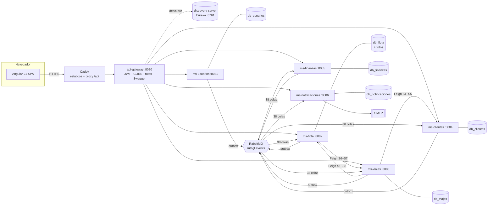

# Arquitectura de RutaGT

Resumen para orientarse en el código. El detalle y la justificación de cada decisión están en [GUIA.md §3–§6](../GUIA.md#3-arquitectura) y en los [ADR](adr/README.md).

## 1. Vista general



## 2. Servicios

| Servicio | Responsabilidad | Manual |
|---|---|---|
| api-gateway | Entrada única, JWT, rutas, CORS, correlación, Swagger agregado | [api-gateway.md](servicios/api-gateway.md) |
| discovery-server | Registro de servicios (Eureka) | [discovery-server.md](servicios/discovery-server.md) |
| ms-usuarios | Identidad, JWT, sucursales, personal y perfiles | [ms-usuarios.md](servicios/ms-usuarios.md) |
| ms-flota | Buses, choferes, rutas, fotos, mapa | [ms-flota.md](servicios/ms-flota.md) |
| ms-viajes | Viajes, salidas y llegadas, venta de boletos | [ms-viajes.md](servicios/ms-viajes.md) |
| ms-clientes | Clientes por NIT, cartera, alquileres | [ms-clientes.md](servicios/ms-clientes.md) |
| ms-finanzas | Configuración, taller, libro contable, reportes financieros | [ms-finanzas.md](servicios/ms-finanzas.md) |
| ms-notificaciones | Correos por eventos, recordatorios de licencias | [ms-notificaciones.md](servicios/ms-notificaciones.md) |

Comunicación: [eventos.md](eventos.md) (22 eventos, 7 llamadas síncronas, 84 % por eventos).

## 3. Código compartido (`backend/common-lib`)

| Paquete | Contenido |
|---|---|
| `events` | `EventEnvelope` y `RoutingKeys` (catálogo de los 22 eventos) |
| `messaging` | `RabbitCommonConfig` (exchanges, convertidor JSON y `RabbitTemplate` con *confirms*) y `Suscripciones.de(...)` (cola + DLQ por evento) |
| `outbox` | `OutboxEvent`, `OutboxService.registrar` (exige transacción), `OutboxPublisher` (cada 1 s, `SKIP LOCKED`, *confirms*) |
| `idempotency` | `IdempotentConsumer.procesar(evento, tipo, handler)` y `processed_event` |
| `errors` | `ApiException` y subclases (400, 403, 404, 409, 422, 503) + `GlobalExceptionHandler` → `ProblemDetail` con `codigo` y `errores` |
| `security` | `SecurityConfig` (JWT HS256, rutas públicas e internas), `UsuarioActual` (datos del token), `Roles` |
| `feign` | `FeignCommonConfig`: propaga el `ProblemDetail` remoto y el id de correlación |
| `web` | `CorrelationIdFilter`, `PageResponse`, `FechaUtil` (zona America/Guatemala), `Nit` (normalización) |
| `reportes` | `ReporteResponse`: formato común de los 12 reportes |
| `openapi` | Esquema *bearer* y servidor `/` para Swagger |
| `db/migration` | `V1_0__infraestructura_eventos.sql` (`outbox_event`, `processed_event`) |

## 4. Estructura de cada microservicio

```
gt.rutagt.<servicio>
├── api/                     Controladores REST + dto/ (records con Bean Validation y @Schema)
├── application/             Casos de uso @Transactional, Eventos.java (payloads), reportes
├── domain/                  Entidades JPA y enums
├── infrastructure/
│   ├── persistence/         Repositorios Spring Data
│   ├── messaging/           EventosListener (@RabbitListener → IdempotentConsumer)
│   └── client/              Clientes Feign (solo flota y viajes)
└── config/                  MensajeriaConfig (suscripciones del servicio)
```

## 5. Frontend (`frontend/src/app`)

```
core/        modelos, clientes HTTP por servicio (api.ts), sesión JWT con refresh (auth.ts),
             utilidades de fechas y errores (util.ts), toasts, íconos, PDF y exportación
shared/      componentes reutilizables: icono, estado, campo-error, vacío, diálogo, paginador,
             tabla de reporte, mapa de asientos y mapa Leaflet
layout/      Portal (público y clientes) y Panel (sucursal y administración) con menú por rol
features/    auth · comun · portal · sucursal · admin · reportes (una carpeta por área, carga diferida)
```

Cada pantalla corresponde a un mockup de `mockups/` (tabla en [GUIA.md §8.4](../GUIA.md#84-cómo-trasladar-los-mockups-a-angular)).

## 6. Despliegue

Ver [despliegue.md](despliegue.md).
