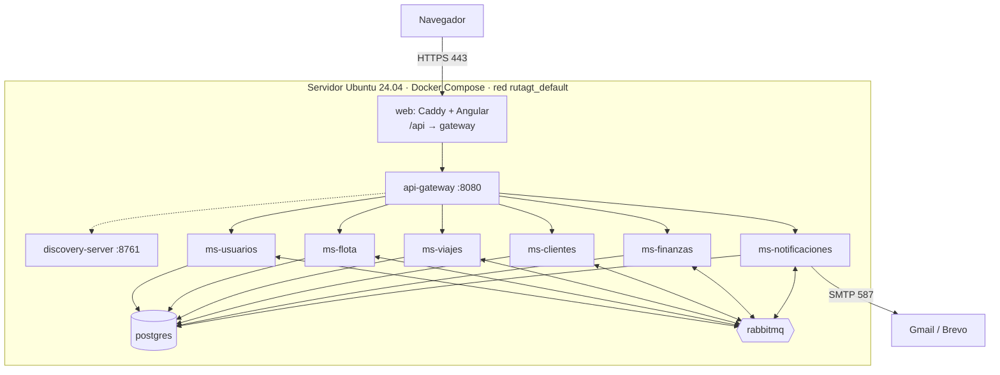

# Despliegue

## 1. Contenedores

| Contenedor | Imagen | Puertos publicados | Notas |
|---|---|---|---|
| `postgres` | `postgres:16-alpine` | — | 6 bases creadas por `infra/postgres/init.sql`; volumen `pgdata` |
| `rabbitmq` | `rabbitmq:3.13-management-alpine` | `127.0.0.1:15672` (consola) | Volumen `rabbitdata` |
| `mailpit` | `axllent/mailpit` | `127.0.0.1:8025` | Solo con `--profile dev` |
| `discovery-server` | `rutagt/discovery-server:1.0.0` | — | Eureka |
| `api-gateway` | `rutagt/api-gateway:1.0.0` | `127.0.0.1:8080` | Swagger agregado |
| `ms-*` (6) | `rutagt/ms-*:1.0.0` | — | Límite de 420 MB cada uno |
| `web` | `rutagt/web:1.0.0` (Caddy + Angular) | `${WEB_HTTP_PORT:-80}`, `${WEB_HTTPS_PORT:-443}` | Único punto expuesto a internet |

Todos los servicios tienen *healthcheck* y `restart: unless-stopped`. Arrancan en orden gracias a `depends_on: condition: service_healthy`:

postgres y rabbitmq → discovery → microservicios → gateway → web.



## 2. Imágenes

- **Backend:** un único `backend/Dockerfile` multi-stage con `ARG SERVICIO`. La etapa de compilación construye todo el reactor Maven una vez (con caché de `~/.m2`). La imagen final tiene solo el JRE 21 alpine y el JAR, y corre con un usuario sin privilegios.
- **Frontend:** `frontend/Dockerfile` compila Angular con Node 22 y copia el resultado a `caddy:2-alpine` junto con `frontend/Caddyfile`.

```bash
docker compose build              # construye las 9 imágenes rutagt/*:1.0.0
```

## 3. Ejecutar localmente con Docker

```bash
cp .env.example .env               # y completar (GUIA.md §11)
# si el puerto 80 de tu máquina está ocupado: WEB_HTTP_PORT=8088 y DOMAIN=":80" en .env
docker compose --profile dev up -d --build --wait
python3 scripts/seed.py            # datos de prueba de 45 días (opcional, ~1-2 min)
```

- Aplicación: http://localhost (o `http://localhost:<WEB_HTTP_PORT>`).
- Swagger: http://localhost:8080/swagger-ui.html.
- Correos: http://localhost:8025.
- RabbitMQ: http://localhost:15672.

Para empezar de cero: `docker compose --profile dev down -v` (borra los volúmenes).

## 4. Producción

1. VM Ubuntu 24.04 con 8 GB de RAM (GUIA §10.7) y puertos 22, 80 y 443 abiertos.
2. Dominio apuntando a la IP (por ejemplo DuckDNS, GUIA §10.6).
3. En el servidor:

```bash
curl -fsSL https://get.docker.com | sudo sh && sudo usermod -aG docker $USER   # y volver a entrar
git clone <url-del-repositorio> rutagt && cd rutagt
cp .env.example .env && nano .env
#  DOMAIN=rutagt.duckdns.org        → Caddy obtiene el certificado de Let's Encrypt solo
#  FRONTEND_URL=https://rutagt.duckdns.org
#  JWT_SECRET nuevo (openssl rand -base64 48), contraseñas fuertes
#  MAIL_* con Gmail o Brevo, MAIL_HOST_EN_DOCKER=smtp.gmail.com (o smtp-relay.brevo.com)
docker compose up -d --build --wait
```

4. Datos de prueba desde tu computadora: `python3 scripts/seed.py --api https://rutagt.duckdns.org --admin-password '<clave>'` (ver `python3 scripts/seed.py --help`).

**Actualizar:** `git pull && docker compose up -d --build`.
**Respaldo:** `docker compose exec postgres pg_dumpall -U rutagt > respaldo_$(date +%F).sql` (incluye las fotos).
**Logs:** `docker compose logs -f ms-viajes`. Todas las líneas llevan el `X-Correlation-Id` de la petición.

## 5. Ejecutar sin Docker (desarrollo)

```bash
docker compose -f docker-compose.infra.yml up -d    # postgres, rabbitmq, mailpit
cd backend && ./mvnw -q install -DskipTests && cd ..
scripts/backend-local.sh iniciar                    # 8 JAR en segundo plano, logs en logs/
npm --prefix frontend start                         # http://localhost:4200 (proxy /api → 8080)
scripts/backend-local.sh estado | detener
scripts/reiniciar-datos.sh                          # borra los datos de la infraestructura de desarrollo
```

## 6. Binarios de la versión

`scripts/empaquetar.sh` compila y deja en `releases/`:
- Los 8 JAR del backend (de 54 a 88 MB cada uno; unos 630 MB en total).
- `rutagt-web-1.0.0.zip` con el frontend compilado.
- `SHA256SUMS.txt`.

Los binarios **no se suben al repositorio** (`.gitignore`): se publican como *release* de GitHub:

```bash
scripts/empaquetar.sh
gh release create v1.0.0 releases/* --title "RutaGT 1.0.0" --notes "Entrega final"
```

Cada JAR se ejecuta con `java -jar ms-flota-1.0.0.jar` y las variables de entorno de GUIA §11.
