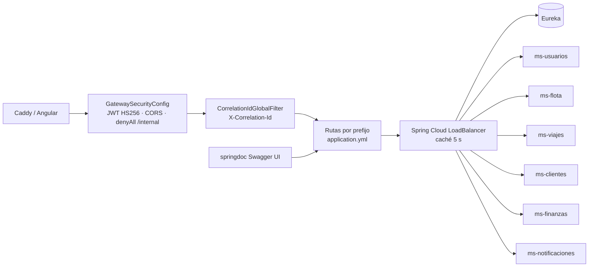
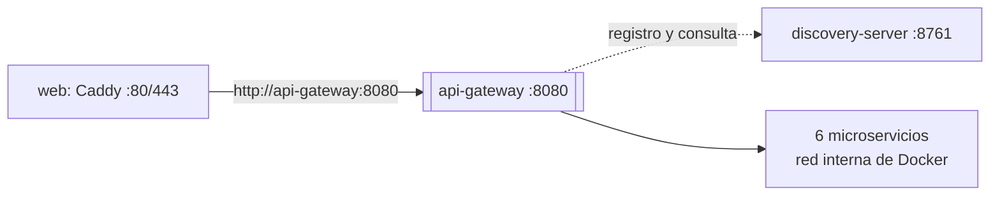

# Manual técnico — api-gateway

| | |
|---|---|
| **Puerto** | 8080 (en Docker solo en `127.0.0.1:8080`; desde internet se entra por Caddy) |
| **Base de datos** | — |
| **Paquete** | `gt.rutagt.gateway` |
| **Tecnología** | Spring Cloud Gateway (WebFlux) + Spring Security *resource server* |
| **Swagger agregado** | http://localhost:8080/swagger-ui.html (selector con los 6 microservicios) |

## 1. Propósito

Es el **único punto de entrada** al backend:
1. **Enruta** por prefijo de ruta hacia cada microservicio, que encuentra por nombre en Eureka (`lb://ms-flota`) con balanceo de carga.
2. **Valida el JWT** (HS256) antes de dejar pasar la petición y responde 401 con `ProblemDetail` en español si falta o expiró.
3. **Bloquea** las rutas internas `/internal/**` (`denyAll`): solo los servicios entre sí pueden usarlas.
4. **CORS** para el frontend en desarrollo (`FRONTEND_URL`). En producción no hace falta porque Caddy sirve frontend y API en el mismo dominio.
5. **Correlación:** asigna `X-Correlation-Id` a cada petición; los servicios lo propagan a sus logs, a las llamadas Feign y a los eventos.
6. **Swagger agregado:** expone `/api-docs/<servicio>` (reescrito a `/v3/api-docs` del servicio) y una sola Swagger UI.

## 2. Diagrama de tablas

No tiene base de datos.

## 3. Diagrama de componentes

## 4. Diagrama de despliegue

## 5. Rutas

| Prefijos | Servicio |
|---|---|
| `/api/auth/**`, `/api/usuarios/**`, `/api/sucursales/**`, `/api/perfil/**` | ms-usuarios |
| `/api/buses/**`, `/api/choferes/**`, `/api/rutas/**`, `/api/archivos/**`, `/api/reportes/flota/**` | ms-flota |
| `/api/viajes/**`, `/api/boletos/**`, `/api/operacion/**`, `/api/reportes/viajes/**` | ms-viajes |
| `/api/clientes/**`, `/api/cartera/**`, `/api/alquileres/**`, `/api/reportes/clientes/**` | ms-clientes |
| `/api/finanzas/**`, `/api/configuracion/**`, `/api/categorias/**`, `/api/taller/**`, `/api/reportes/finanzas/**` | ms-finanzas |
| `/api/notificaciones/**` | ms-notificaciones |
| `/api-docs/<servicio>` | OpenAPI de cada servicio (para la Swagger UI agregada) |

**Rutas públicas** (sin token): `/api/auth/**`; `GET` en `/api/viajes/publicos/**`, `/api/sucursales/**`, `/api/archivos/**` y `/api/configuracion/publica`; además `/actuator/health` y Swagger. **Todo lo demás requiere token**, y cada servicio vuelve a validar el token y el rol ([ADR-0010](../adr/0010-jwt.md)).

## 6. Eventos

No publica ni consume eventos.

## 7. Llamadas síncronas

Solo reenvía peticiones: *timeout* de conexión 3 s y de respuesta 30 s.

## 8. Reglas

- Las rutas `/internal/**` nunca llegan a los servicios: sin token responden 401 y con token 404 `RUTA_NO_EXISTE`, así desde fuera no se revela que existen.
- La caché del balanceador dura 5 s: tras reiniciar un servicio, el gateway lo vuelve a encontrar en segundos.
- Cabeceras CORS duplicadas por los servicios se dejan en una sola (`DedupeResponseHeader`).

## 9. Variables de entorno

| Variable | Uso | Valor por defecto |
|---|---|---|
| `JWT_SECRET` | Validar la firma del token | — (obligatoria) |
| `EUREKA_URL` | Descubrir los servicios | `http://localhost:8761/eureka` |
| `FRONTEND_URL` | Origen permitido por CORS | `http://localhost:4200` |
| `JAVA_OPTS` | Memoria de la JVM | `-Xms96m -Xmx256m …` |

## 10. Pruebas

El gateway no tiene lógica de negocio propia. Se prueba de extremo a extremo con la colección Postman (`docs/postman/`): las 95 peticiones pasan por él, incluidas las que verifican 401 sin token y 403 por rol insuficiente.
