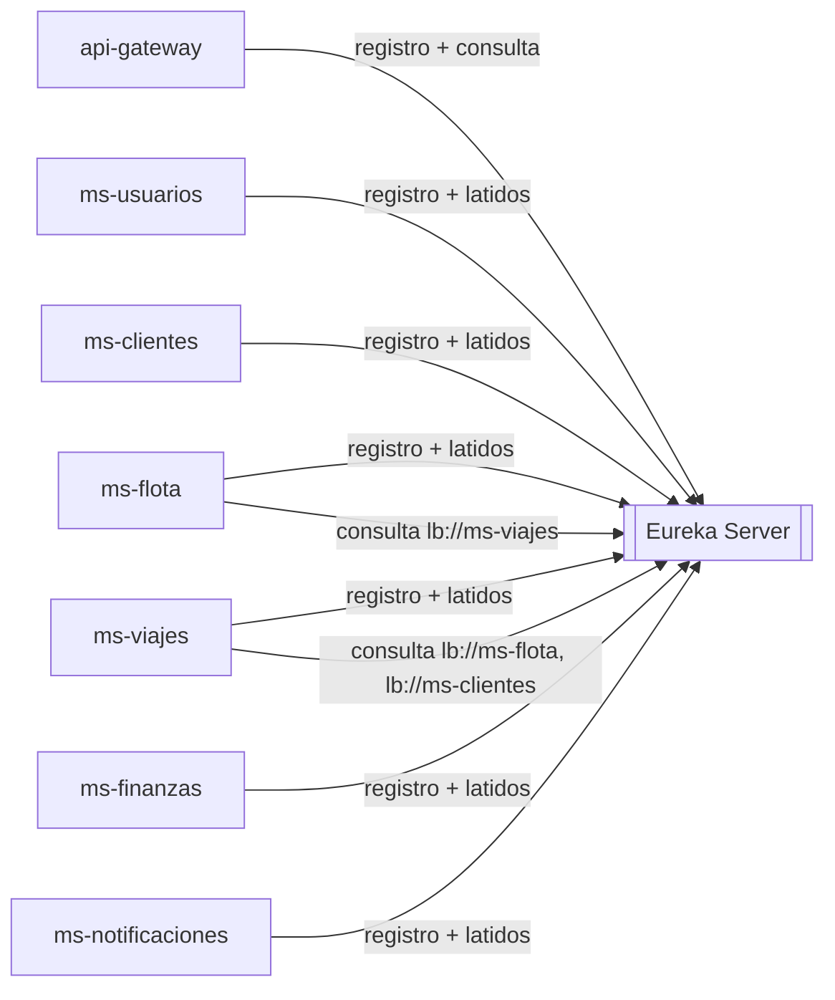

# Manual técnico — discovery-server

| | |
|---|---|
| **Puerto** | 8761 |
| **Base de datos** | — |
| **Paquete** | `gt.rutagt.discovery` |
| **Tecnología** | Spring Cloud Netflix Eureka Server |
| **Panel** | http://localhost:8761 (solo en desarrollo; en Docker no se publica) |

## 1. Propósito

Registro de servicios. Cada microservicio y el gateway se registran al arrancar con su nombre (`ms-flota`, `ms-viajes`, …) y envían latidos. El gateway y los clientes Feign resuelven `lb://<nombre>` contra este registro, por lo que se pueden levantar varias instancias de un servicio sin cambiar configuración.

## 2. Diagrama de tablas

No tiene base de datos: el registro vive en memoria.

## 3. Diagrama de componentes

## 4. Diagrama de despliegue

Contenedor `discovery-server` en la red interna de Docker, sin puertos publicados. Es el primero en arrancar: los demás esperan a que su *healthcheck* esté sano (`depends_on: service_healthy`).

## 5. Endpoints

| Ruta | Uso |
|---|---|
| `/` | Panel web con las instancias registradas |
| `/eureka/**` | API de registro (la usan los clientes Eureka) |
| `/actuator/health` | *Healthcheck* |

## 6–8. Eventos, llamadas y reglas

- No publica ni consume eventos.
- Autopreservación desactivada (`enable-self-preservation: false`) y desalojo cada 10 s: una instancia caída desaparece rápido del registro y el gateway deja de enviarle tráfico.
- No se registra a sí mismo (`register-with-eureka: false`).

## 9. Variables de entorno

| Variable | Uso | Valor por defecto |
|---|---|---|
| `EUREKA_HOSTNAME` | Nombre del host del servidor | `localhost` (`discovery-server` en Docker) |
| `JAVA_OPTS` | Memoria de la JVM | — |

## 10. Pruebas

Sin lógica propia. Se verifica de forma indirecta: el *healthcheck* de Docker y el arranque correcto de los demás servicios, que fallan si no pueden registrarse.
