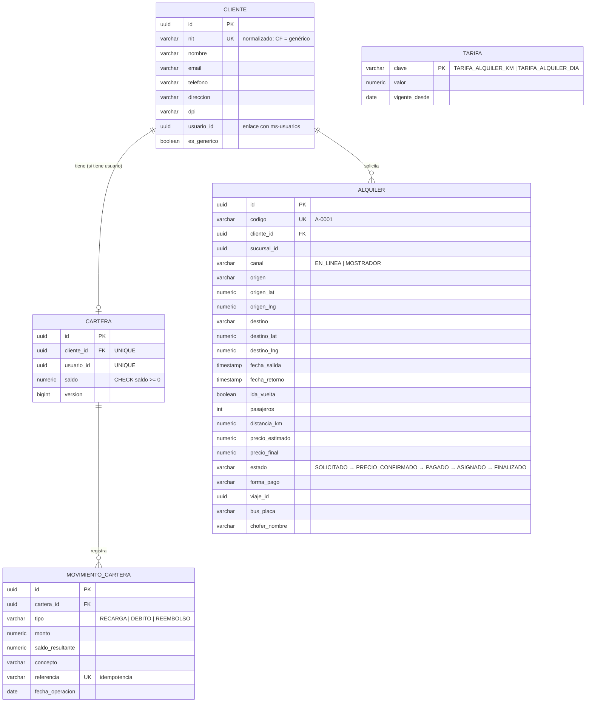
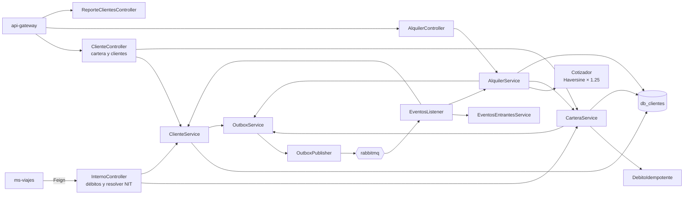
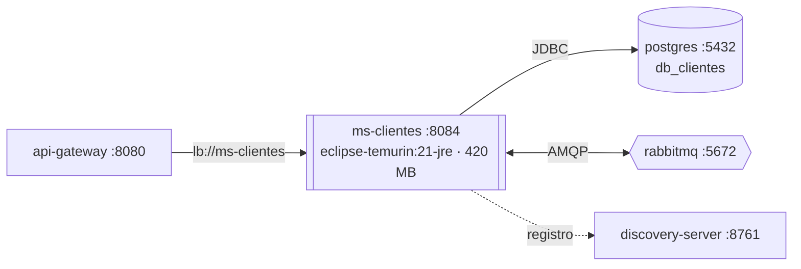

# Manual técnico — ms-clientes

| | |
|---|---|
| **Puerto** | 8084 |
| **Base de datos** | `db_clientes` |
| **Paquete** | `gt.rutagt.clientes` |
| **Swagger** | http://localhost:8080/swagger-ui.html → *ms-clientes* |
| **Módulo del enunciado** | Clientes y alquileres (clientes por NIT, cartera digital, alquiler privado de buses, ingresos por alquiler) |

## 1. Propósito

- **Clientes:** uno por NIT normalizado, más el genérico **CF** para ventas sin NIT. Si alguien que compró en mostrador crea su cuenta después, su historial se enlaza solo ([ADR-0007](../adr/0007-clientes-por-nit.md)).
- **Cartera digital:** recargas, débitos y reembolsos con garantías fuertes (nunca saldo negativo, nunca doble cobro).
- **Alquileres privados:** solicitud con mapa y precio estimado, confirmación o ajuste del precio por la sucursal, pago y seguimiento hasta que el viaje privado termina.

## 2. Diagrama de tablas

`tarifa` es una réplica de la configuración de ms-finanzas. El estado del alquiler también puede ser `RECHAZADO` o `CANCELADO`.

## 3. Diagrama de componentes

## 4. Diagrama de despliegue

- Imagen `rutagt/ms-clientes:1.0.0` construida con `backend/Dockerfile` (`--build-arg SERVICIO=ms-clientes`).
- *Healthcheck*: `GET /actuator/health`. El contenedor no publica puertos al host: solo el gateway lo alcanza por la red interna de Docker.
- Al arrancar, Flyway aplica `V1_0__infraestructura_eventos.sql` (outbox e idempotencia, de common-lib) y la migración propia del servicio.

## 5. Endpoints

Cartera y alquileres propios: `CLIENTE`. Bandeja de alquileres, precio, rechazo y alquiler presencial: `ADMIN_SUCURSAL` (su sucursal). Reportes: `ADMIN_SISTEMA` y `ADMIN_SUCURSAL`.

| Grupo | Método | Ruta | Descripción |
|---|---|---|---|
| Alquileres | `GET` | `/api/alquileres` | Bandeja de alquileres de la sucursal |
| Alquileres | `POST` | `/api/alquileres` | Solicitar alquiler |
| Alquileres | `POST` | `/api/alquileres/cotizar` | Calcular precio estimado (sin guardar) |
| Alquileres | `GET` | `/api/alquileres/mios` | Mis alquileres |
| Alquileres | `GET` | `/api/alquileres/{id}` | Ver alquiler |
| Alquileres | `POST` | `/api/alquileres/{id}/pago` | Pagar alquiler |
| Alquileres | `PATCH` | `/api/alquileres/{id}/precio` | Confirmar o modificar el precio |
| Alquileres | `PATCH` | `/api/alquileres/{id}/rechazar` | Rechazar solicitud |
| Clientes y cartera | `GET` | `/api/cartera` | Mi cartera: saldo y movimientos |
| Clientes y cartera | `POST` | `/api/cartera/recargas` | Recargar mi cartera |
| Clientes y cartera | `GET` | `/api/clientes` | Buscar cliente por NIT (mostrador) |
| Clientes y cartera | `GET` | `/api/clientes/me` | Mis datos de cliente y saldo |
| Reportes de clientes | `GET` | `/api/reportes/clientes/ingresos-alquiler` | Ingresos por alquiler de buses |

**API interna** (oculta en Swagger y bloqueada en el gateway; la usa ms-viajes):

| Método | Ruta | Para qué |
|---|---|---|
| `POST` | `/internal/cartera/debitos` (cabecera `Idempotency-Key`) | Cobrar una compra en línea |
| `GET` | `/internal/cartera/debitos/{referencia}` | Consultar si un débito se aplicó (reconciliador) |
| `POST` | `/internal/clientes/resolver` | Obtener o crear el cliente de un NIT en mostrador |

## 6. Eventos

**Publicados**

| Evento | Routing key | Cuándo | Consumidores |
|---|---|---|---|
| `CarteraRecargada` | `clientes.cartera.recargada` | Recarga de saldo | ms-notificaciones |
| `CarteraReembolsada` | `clientes.cartera.reembolsada` | Reembolso por viaje o alquiler cancelado | ms-notificaciones |
| `ClienteVinculado` | `clientes.cliente.vinculado` | Un usuario queda enlazado a su cliente por NIT | ms-viajes |
| `AlquilerSolicitado` | `clientes.alquiler.solicitado` | Nueva solicitud | ms-notificaciones |
| `AlquilerPrecioConfirmado` | `clientes.alquiler.precio-confirmado` | La sucursal confirma o ajusta el precio | ms-notificaciones |
| `AlquilerRechazado` | `clientes.alquiler.rechazado` | La sucursal rechaza la solicitud | ms-notificaciones |
| `AlquilerPagado` | `clientes.alquiler.pagado` | Pago con cartera o pago presencial | ms-viajes (crea el viaje privado), ms-finanzas (ingreso), ms-notificaciones |

**Consumidos**

| Evento | Productor | Qué hace |
|---|---|---|
| `UsuarioClienteRegistrado` | ms-usuarios | Crea el cliente o **lo enlaza** si ya existía por NIT; crea su cartera; publica `ClienteVinculado` |
| `PerfilActualizado` | ms-usuarios | Actualiza los datos del cliente (y el enlace si cambió el NIT) |
| `ConfiguracionActualizada` | ms-finanzas | Actualiza las tarifas de alquiler |
| `AlquilerAsignado` | ms-viajes | Guarda bus y chofer en el alquiler → `ASIGNADO` |
| `ViajeFinalizado` | ms-viajes | Si el viaje era de un alquiler → `FINALIZADO` |
| `ViajeEliminado` | ms-viajes | Reembolsa las compras pagadas con cartera; si era un alquiler → `CANCELADO` y reembolso |

## 7. Llamadas síncronas

ms-clientes **no llama** a otros servicios; recibe las tres llamadas internas de ms-viajes (S3, S4 y S5 del catálogo).

## 8. Reglas de negocio

**Cartera**
- **Débito atómico:** `UPDATE cartera SET saldo = saldo - :monto WHERE id = :id AND saldo >= :monto`. Si no afecta filas → `SALDO_INSUFICIENTE`. Además `CHECK (saldo >= 0)` en la base. Ni con compras simultáneas el saldo queda negativo.
- **Idempotencia:** cada débito tiene una `referencia` única (el id de la compra). Si se repite, se devuelve el mismo resultado sin cobrar de nuevo (`DebitoIdempotente`). Los reembolsos usan `REEMB-<referencia>` y tampoco se duplican.
- Las recargas **no son ingreso** de la empresa (es dinero del cliente en custodia); el ingreso ocurre al comprar.
- La fecha de cada operación se ingresa manualmente (por defecto, hoy).

**Alquileres**
- Precio estimado (`Cotizador`):
  - `km_tramo = Haversine(origen, destino) × 1.25` (factor de carretera, mínimo 1 km).
  - `km_total = km_tramo × 2` si es ida y vuelta.
  - `días` = días calendario entre la salida y el retorno (mínimo 1).
  - `estimado = km_total × TARIFA_ALQUILER_KM + días × TARIFA_ALQUILER_DIA`.
- Validaciones de fechas e ida y vuelta: `RETORNO_INVALIDO`, `RETORNO_REQUERIDO`. Sin tarifas cargadas: `TARIFA_NO_CONFIGURADA`.
- El precio solo se fija antes del pago (`ESTADO_INVALIDO`).
- Pago en línea con cartera (débito local con referencia única) o pago presencial registrado por el administrador.
- Alquiler presencial: el administrador indica el NIT del cliente (`NIT_REQUERIDO`).
- Un cliente solo ve sus alquileres; un administrador, los de su sucursal (`NO_ES_SU_ALQUILER`, `OTRA_SUCURSAL`).
- El ingreso se asigna a la sucursal que atiende el alquiler.

## 9. Variables de entorno

| Variable | Uso | Valor por defecto |
|---|---|---|
| `DB_HOST`, `DB_PORT`, `DB_USER`, `DB_PASSWORD` | Conexión a PostgreSQL | `localhost`, `5432`, `rutagt`, `rutagt` |
| `RABBITMQ_HOST`, `RABBITMQ_PORT`, `RABBITMQ_USER`, `RABBITMQ_PASSWORD` | Conexión a RabbitMQ | `localhost`, `5672`, `rutagt`, `rutagt` |
| `EUREKA_URL` | Registro en Eureka | `http://localhost:8761/eureka` |
| `JWT_SECRET` | Validación del token (mismo valor en todos los servicios) | — (obligatoria) |
| `JAVA_OPTS` | Memoria de la JVM en Docker | `-Xms96m -Xmx256m …` |

## 10. Pruebas y cobertura

| Tipo | Clase | Pruebas | Qué cubre |
|---|---|---|---|
| Integración (Testcontainers) | `ClientesIT` | 6 | Recarga y débito idempotente; **débitos concurrentes que nunca dejan saldo negativo**; venta de mostrador enlazada al crear la cuenta; reembolso de viaje eliminado una sola vez; flujo completo de alquiler; alquiler presencial, rechazo y cancelación con reembolso |
| Unitarias | `ClientesUnitTest` | 3 | Cotización solo ida, ida y vuelta de varios días, retorno inválido |

Cobertura de líneas (integración): **95.6 %**.
