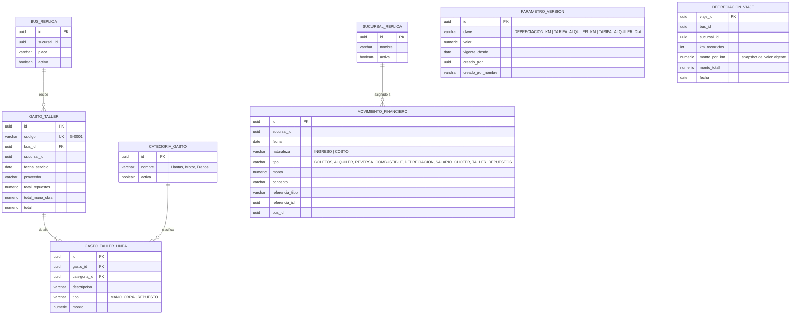
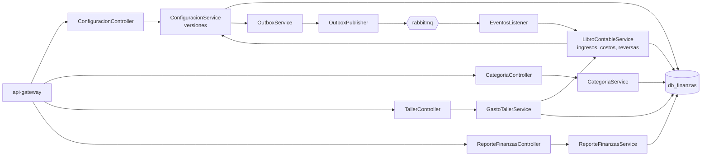
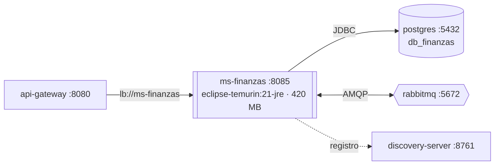

# Manual técnico — ms-finanzas

| | |
|---|---|
| **Puerto** | 8085 |
| **Base de datos** | `db_finanzas` |
| **Paquete** | `gt.rutagt.finanzas` |
| **Swagger** | http://localhost:8080/swagger-ui.html → *ms-finanzas* |
| **Módulo del enunciado** | Finanzas y administración (configuración, categorías, gastos de taller, combustible, depreciación, ingresos, gastos y ganancias) |

## 1. Propósito

Lleva el **libro contable** de la empresa sin que ningún otro servicio le escriba directamente: cada ingreso o costo nace de un **evento**.
- Boletos vendidos y alquileres pagados → ingresos.
- Viajes finalizados → combustible, salario del chofer y depreciación.
- Viajes eliminados → reversas.

Los gastos de taller se registran aquí directamente. Además administra la **configuración versionada** (depreciación por km y tarifas de alquiler) y el catálogo de **categorías de gasto**, y genera los reportes financieros del sistema y de cada sucursal.

## 2. Diagrama de tablas

`UNIQUE (referencia_tipo, referencia_id, tipo)` en `movimiento_financiero` es la segunda barrera contra dinero duplicado (la primera es `processed_event`). Datos iniciales de la migración:
- Depreciación Q 1.85/km.
- Tarifas de alquiler Q 14/km y Q 800/día.
- 8 categorías de gasto.

## 3. Diagrama de componentes

## 4. Diagrama de despliegue

- Imagen `rutagt/ms-finanzas:1.0.0` construida con `backend/Dockerfile` (`--build-arg SERVICIO=ms-finanzas`).
- *Healthcheck*: `GET /actuator/health`. El contenedor no publica puertos al host: solo el gateway lo alcanza por la red interna de Docker.
- Al arrancar, Flyway aplica `V1_0__infraestructura_eventos.sql` (outbox e idempotencia, de common-lib) y la migración propia del servicio.

## 5. Endpoints

Configuración y categorías: escritura `ADMIN_SISTEMA`; la consulta de categorías también para `ADMIN_SUCURSAL`. `GET /api/configuracion/publica` es pública (tarifas para el portal). Taller: registro `ADMIN_SUCURSAL` (su sucursal), consulta también `ADMIN_SISTEMA`. Reportes de ingresos, gastos, ganancias y resumen: `ADMIN_SISTEMA`. Taller por categoría, taller por bus y depreciación por bus: `ADMIN_SISTEMA` y `ADMIN_SUCURSAL` (filtrado a su sucursal).

| Grupo | Método | Ruta | Descripción |
|---|---|---|---|
| Categorías de gasto | `GET` | `/api/categorias` | Listar categorías |
| Categorías de gasto | `POST` | `/api/categorias` | Agregar categoría |
| Categorías de gasto | `PUT` | `/api/categorias/{id}` | Renombrar categoría |
| Categorías de gasto | `DELETE` | `/api/categorias/{id}` | Eliminar categoría |
| Categorías de gasto | `PATCH` | `/api/categorias/{id}/estado` | Activar o desactivar categoría |
| Configuración | `GET` | `/api/configuracion` | Valores vigentes |
| Configuración | `POST` | `/api/configuracion` | Registrar nueva versión de un parámetro |
| Configuración | `GET` | `/api/configuracion/historial` | Historial de un parámetro |
| Configuración | `GET` | `/api/configuracion/publica` | Valores vigentes (público, para mostrar tarifas de alquiler) |
| Reportes financieros | `GET` | `/api/reportes/finanzas/depreciacion-por-bus` | Depreciación por bus |
| Reportes financieros | `GET` | `/api/reportes/finanzas/ganancias` | Ganancias: ingresos, costos y ganancia neta por sucursal |
| Reportes financieros | `GET` | `/api/reportes/finanzas/gastos` | Gastos por sucursal (combustible, taller, repuestos, depreciación, salarios) |
| Reportes financieros | `GET` | `/api/reportes/finanzas/ingresos` | Ingresos por sucursal (subtotal por sucursal y total global) |
| Reportes financieros | `GET` | `/api/reportes/finanzas/resumen` | Resumen para el tablero del administrador del sistema |
| Reportes financieros | `GET` | `/api/reportes/finanzas/taller-por-bus` | Gastos de taller por bus agrupados por categoría |
| Reportes financieros | `GET` | `/api/reportes/finanzas/taller-por-categoria` | Gastos de taller por categoría |
| Taller | `GET` | `/api/taller/gastos` | Listar gastos de taller |
| Taller | `POST` | `/api/taller/gastos` | Registrar gasto de taller |
| Taller | `GET` | `/api/taller/gastos/{id}` | Ver gasto de taller |

## 6. Eventos

**Publicado**

| Evento | Routing key | Cuándo | Consumidores |
|---|---|---|---|
| `ConfiguracionActualizada` | `finanzas.configuracion.actualizada` | Nueva versión de un parámetro | ms-clientes (tarifas de alquiler) |

**Consumidos** (alimentan el libro contable)

| Evento | Productor | Asiento contable |
|---|---|---|
| `SucursalGuardada` | ms-usuarios | Réplica de sucursales |
| `BusGuardado` | ms-flota | Réplica de buses (para taller y reportes por bus) |
| `BoletosVendidos` | ms-viajes | **INGRESO** `BOLETOS` en la sucursal de origen de la ruta, con la fecha de pago indicada |
| `AlquilerPagado` | ms-clientes | **INGRESO** `ALQUILER` en la sucursal que atiende el alquiler |
| `ViajeFinalizado` | ms-viajes | **COSTOS** `COMBUSTIBLE`, `SALARIO_CHOFER` y `DEPRECIACION` (km × monto por km vigente el día de la llegada, con *snapshot* en `depreciacion_viaje`) |
| `ViajeEliminado` | ms-viajes | **REVERSA** de los ingresos de sus compras y de su alquiler |

## 7. Llamadas síncronas

Ninguna.

## 8. Reglas de negocio

- **Configuración versionada** ([ADR-0006](../adr/0006-configuracion-versionada.md)): cada cambio inserta una versión con `vigente_desde` (por defecto hoy; puede ser futura). Cambiar la depreciación **no altera** los viajes ya registrados.
- **Categorías:** se agregan sin tocar código, con nombre único (`CATEGORIA_EXISTENTE`). Solo se eliminan si no tienen gastos; con gastos únicamente se desactivan (`CATEGORIA_CON_GASTOS`). Una categoría inactiva no se usa en gastos nuevos (`CATEGORIA_INACTIVA`).
- **Gastos de taller:** encabezado (bus, fecha de servicio, proveedor) más líneas con categoría obligatoria, tipo (mano de obra o repuesto) y monto. Los totales se calculan desde las líneas. Generan costos `TALLER` (mano de obra) y `REPUESTOS`. Un administrador solo registra gastos de buses de su sucursal (`OTRA_SUCURSAL`).
- **Asignación a sucursal:**
  - Boletos → sucursal de origen de la ruta.
  - Alquiler → sucursal que lo atiende.
  - Costos de viaje → sucursal del viaje.
  - Taller → sucursal del bus.
  - Las recargas de cartera **no** son ingreso.
- **Idempotencia del dinero:** un evento repetido nunca duplica un asiento (`processed_event` + `UNIQUE` de referencia).
- **Reportes:** todos aceptan `desde`/`hasta` (sin fechas = todo el historial). El reporte financiero agrupa por sucursal con subtotales y total global; responden con el formato común `ReporteResponse` ([ADR-0008](../adr/0008-pdf-en-el-frontend.md)).

## 9. Variables de entorno

| Variable | Uso | Valor por defecto |
|---|---|---|
| `DB_HOST`, `DB_PORT`, `DB_USER`, `DB_PASSWORD` | Conexión a PostgreSQL | `localhost`, `5432`, `rutagt`, `rutagt` |
| `RABBITMQ_HOST`, `RABBITMQ_PORT`, `RABBITMQ_USER`, `RABBITMQ_PASSWORD` | Conexión a RabbitMQ | `localhost`, `5672`, `rutagt`, `rutagt` |
| `EUREKA_URL` | Registro en Eureka | `http://localhost:8761/eureka` |
| `JWT_SECRET` | Validación del token (mismo valor en todos los servicios) | — (obligatoria) |
| `JAVA_OPTS` | Memoria de la JVM en Docker | `-Xms96m -Xmx256m …` |

## 10. Pruebas y cobertura

| Tipo | Clase | Pruebas | Qué cubre |
|---|---|---|---|
| Integración (Testcontainers) | `FinanzasIT` | 4 | La depreciación usa el valor vigente y cambiarlo no altera el histórico; ingresos, reversas y reportes financieros; gasto de taller con detalle y catálogo; réplicas de sucursal y bus |
| Unitarias | `FinanzasUnitTest` | 3 | Totales del gasto desde sus líneas, valor vigente por fecha, versión siempre nueva |

Cobertura de líneas (integración): **99.0 %**.
