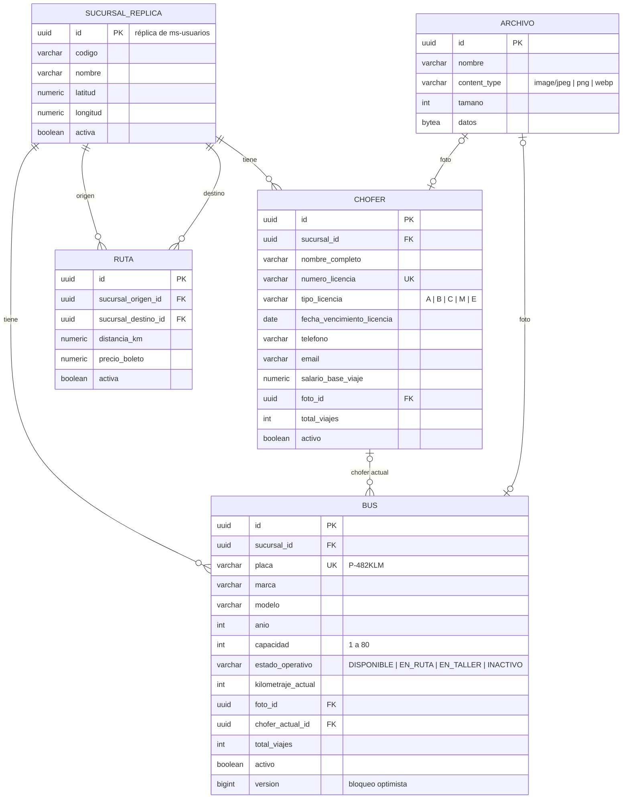
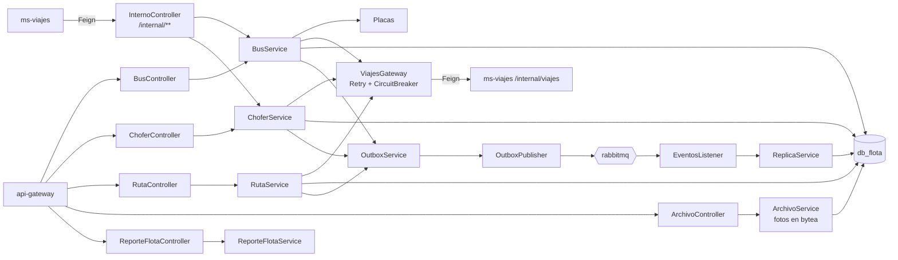

# Manual técnico — ms-flota

| | |
|---|---|
| **Puerto** | 8082 |
| **Base de datos** | `db_flota` |
| **Paquete** | `gt.rutagt.flota` |
| **Swagger** | http://localhost:8080/swagger-ui.html → *ms-flota* |
| **Módulo del enunciado** | Flota (buses, choferes, rutas, mapa de rutas, listados) |

## 1. Propósito

Administra los **recursos físicos** de cada sucursal:
- **Buses:** placa, marca, modelo, año, capacidad, estado operativo, kilometraje y foto.
- **Choferes:** licencia, tipo, vencimiento, salario base por viaje y foto.
- **Rutas:** de la sucursal de origen hacia otra sucursal, con distancia y precio del boleto.

Expone el **mapa de rutas**, los reportes de buses y choferes, y una API interna que ms-viajes consulta antes de programar un viaje. Mantiene el kilometraje y los contadores de viajes con los eventos de salida y llegada que publica ms-viajes.

## 2. Diagrama de tablas



Restricciones en la base: `UNIQUE (sucursal_origen_id, sucursal_destino_id)` y `CHECK (sucursal_origen_id <> sucursal_destino_id)` en rutas; `CHECK` de año, capacidad, kilometraje, estado y tipo de licencia.

## 3. Diagrama de componentes



## 4. Diagrama de despliegue

```mermaid
flowchart LR
  GW[api-gateway :8080] -->|lb://ms-flota| SVC[[ms-flota :8082<br/>eclipse-temurin:21-jre · 420 MB]]
  SVC -->|JDBC| PG[(postgres :5432<br/>db_flota (incluye las fotos))]
  SVC <-->|AMQP| MQ{{rabbitmq :5672}}
  SVC -. registro .-> EU[discovery-server :8761]
```

- Imagen `rutagt/ms-flota:1.0.0` construida con `backend/Dockerfile` (`--build-arg SERVICIO=ms-flota`).
- *Healthcheck*: `GET /actuator/health`. El contenedor no publica puertos al host: solo el gateway lo alcanza por la red interna de Docker.
- Al arrancar, Flyway aplica `V1_0__infraestructura_eventos.sql` (outbox e idempotencia, de common-lib) y la migración propia del servicio.

## 5. Endpoints

Gestión: `ADMIN_SUCURSAL` (solo su sucursal). Consulta: también `ADMIN_SISTEMA`. Públicos: `GET /api/archivos/{id}` (fotos, con caché de 30 días).

| Grupo | Método | Ruta | Descripción |
|---|---|---|---|
| Archivos | `GET` | `/api/archivos/{id}` | Descargar una foto |
| Buses | `GET` | `/api/buses` | Listado de buses |
| Buses | `POST` | `/api/buses` | Registrar bus |
| Buses | `GET` | `/api/buses/opciones` | Buses activos de mi sucursal (para listas de selección) |
| Buses | `GET` | `/api/buses/{id}` | Ver bus |
| Buses | `PUT` | `/api/buses/{id}` | Modificar bus |
| Buses | `PATCH` | `/api/buses/{id}/activar` | Reactivar bus |
| Buses | `PATCH` | `/api/buses/{id}/desactivar` | Desactivar bus |
| Buses | `PUT` | `/api/buses/{id}/foto` | Subir o reemplazar la foto del bus |
| Choferes | `GET` | `/api/choferes` | Listado de choferes |
| Choferes | `POST` | `/api/choferes` | Registrar chofer |
| Choferes | `GET` | `/api/choferes/opciones` | Choferes activos con licencia vigente en la fecha (para asignar viajes) |
| Choferes | `GET` | `/api/choferes/{id}` | Ver chofer |
| Choferes | `PUT` | `/api/choferes/{id}` | Modificar chofer |
| Choferes | `PATCH` | `/api/choferes/{id}/activar` | Reactivar chofer |
| Choferes | `PATCH` | `/api/choferes/{id}/desactivar` | Desactivar chofer |
| Choferes | `PUT` | `/api/choferes/{id}/foto` | Subir o reemplazar la foto del chofer |
| Reportes de flota | `GET` | `/api/reportes/flota/buses` | Listado general de buses |
| Reportes de flota | `GET` | `/api/reportes/flota/choferes` | Listado general de choferes |
| Reportes de flota | `GET` | `/api/reportes/flota/mapa-rutas` | Mapa de rutas |
| Rutas | `GET` | `/api/rutas` | Listar rutas |
| Rutas | `POST` | `/api/rutas` | Crear ruta |
| Rutas | `GET` | `/api/rutas/{id}` | Ver ruta |
| Rutas | `PUT` | `/api/rutas/{id}` | Modificar distancia y precio de la ruta |
| Rutas | `DELETE` | `/api/rutas/{id}` | Eliminar ruta |
| Rutas | `PATCH` | `/api/rutas/{id}/estado` | Activar o desactivar ruta |

**API interna** (oculta en Swagger con `@Hidden` y bloqueada en el gateway con `denyAll`):

| Método | Ruta | Usada por |
|---|---|---|
| `GET` | `/internal/buses/{id}/validar-asignacion?sucursalId&capacidadMinima` | ms-viajes al programar un viaje o asignar un alquiler |
| `GET` | `/internal/choferes/{id}/validar-asignacion?sucursalId&fecha` | ms-viajes (licencia vigente en la fecha del viaje) |

## 6. Eventos

**Publicados**

| Evento | Routing key | Cuándo | Consumidores |
|---|---|---|---|
| `BusGuardado` | `flota.bus.guardado` | Alta, cambios, estado, desactivación o fin de un viaje | ms-viajes, ms-finanzas |
| `ChoferGuardado` | `flota.chofer.guardado` | Alta, cambios o desactivación | ms-viajes, ms-notificaciones |
| `RutaGuardada` | `flota.ruta.guardada` | Alta, cambios o eliminación | ms-viajes |

**Consumidos**

| Evento | Productor | Qué hace |
|---|---|---|
| `SucursalGuardada` | ms-usuarios | Actualiza `sucursal_replica` (nombre, coordenadas para el mapa, estado) |
| `ViajeIniciado` | ms-viajes | El bus queda `EN_RUTA` con su chofer actual |
| `ViajeFinalizado` | ms-viajes | Kilometraje final, bus `DISPONIBLE` y +1 viaje para el bus y el chofer |

## 7. Llamadas síncronas

| Hacia | Endpoint | Para qué | Resiliencia |
|---|---|---|---|
| ms-viajes | `GET /internal/viajes/activos` | No desactivar un bus o chofer con viajes programados o en ruta | Timeout 3 s, 3 reintentos, circuit breaker (50 % de fallos en 10 llamadas → abierto 15 s) |
| ms-viajes | `GET /internal/viajes/existe` | No eliminar una ruta que tiene viajes | Igual |

Si ms-viajes no responde, ms-flota **falla de forma segura** con 503 (`SERVICIO_NO_DISPONIBLE`): no desactiva ni elimina nada a ciegas (`ViajesGateway`).

## 8. Reglas de negocio

| Regla | Código |
|---|---|
| Placa guatemalteca normalizada (`p 482 klm` → `P-482KLM`) y única | `PLACA_EN_USO` (409) |
| Año entre 1980 y el año siguiente al actual; capacidad 1–80; kilometraje que nunca baja | `ANIO_INVALIDO`, `KM_MENOR` |
| No se cambia el estado de un bus `EN_RUTA` (lo maneja el ciclo del viaje) | `BUS_EN_RUTA` |
| Un bus o chofer con viajes activos **no se desactiva** | `BUS_CON_VIAJES`, `CHOFER_CON_VIAJES` (409) |
| Número de licencia único | `LICENCIA_EN_USO` (409) |
| Para asignar: bus activo, de la sucursal, no en taller y con capacidad suficiente; chofer activo, de la sucursal y con licencia **vigente en la fecha del viaje** | `BUS_INACTIVO`, `BUS_EN_TALLER`, `BUS_OTRA_SUCURSAL`, `CAPACIDAD_INSUFICIENTE`, `CHOFER_INACTIVO`, `CHOFER_OTRA_SUCURSAL`, `LICENCIA_VENCIDA` |
| El salario de un chofer en un viaje de alquiler es su salario base + 15 % | — |
| Las rutas salen de la sucursal del administrador, hacia otra sucursal activa; una sola ruta por par origen-destino; el destino no se cambia | `NO_ES_ORIGEN`, `MISMA_SUCURSAL`, `DESTINO_INACTIVO`, `RUTA_EXISTENTE`, `DESTINO_INMUTABLE` |
| Una ruta con viajes no se elimina (se puede desactivar) | `RUTA_CON_VIAJES` (409) |
| Fotos: JPG, PNG o WebP de máximo 5 MB ([ADR-0009](../adr/0009-fotos-en-postgresql.md)) | `FORMATO_INVALIDO`, `ARCHIVO_MUY_GRANDE` |
| Un administrador solo ve y modifica la flota de **su** sucursal | `OTRA_SUCURSAL` (403) |

## 9. Variables de entorno

| Variable | Uso | Valor por defecto |
|---|---|---|
| `DB_HOST`, `DB_PORT`, `DB_USER`, `DB_PASSWORD` | Conexión a PostgreSQL | `localhost`, `5432`, `rutagt`, `rutagt` |
| `RABBITMQ_HOST`, `RABBITMQ_PORT`, `RABBITMQ_USER`, `RABBITMQ_PASSWORD` | Conexión a RabbitMQ | `localhost`, `5672`, `rutagt`, `rutagt` |
| `EUREKA_URL` | Registro en Eureka | `http://localhost:8761/eureka` |
| `JWT_SECRET` | Validación del token (mismo valor en todos los servicios) | — (obligatoria) |
| `JAVA_OPTS` | Memoria de la JVM en Docker | `-Xms96m -Xmx256m …` |

## 10. Pruebas y cobertura

| Tipo | Clase | Pruebas | Qué cubre |
|---|---|---|---|
| Integración (Testcontainers; `ViajesClient` simulado con `@MockitoBean`) | `FlotaIT` | 6 | CRUD de buses con foto y reglas de desactivación, fallo seguro si ms-viajes no responde, validación interna de asignación, CRUD de choferes, rutas y mapa, eventos de viaje que actualizan bus y chofer |
| Unitarias | `FlotaUnitTest` | 4 | Normalización de placas, salario de alquiler, vigencia de licencia, ciclo de viaje del bus |

Cobertura de líneas (integración): **94.5 %**.
