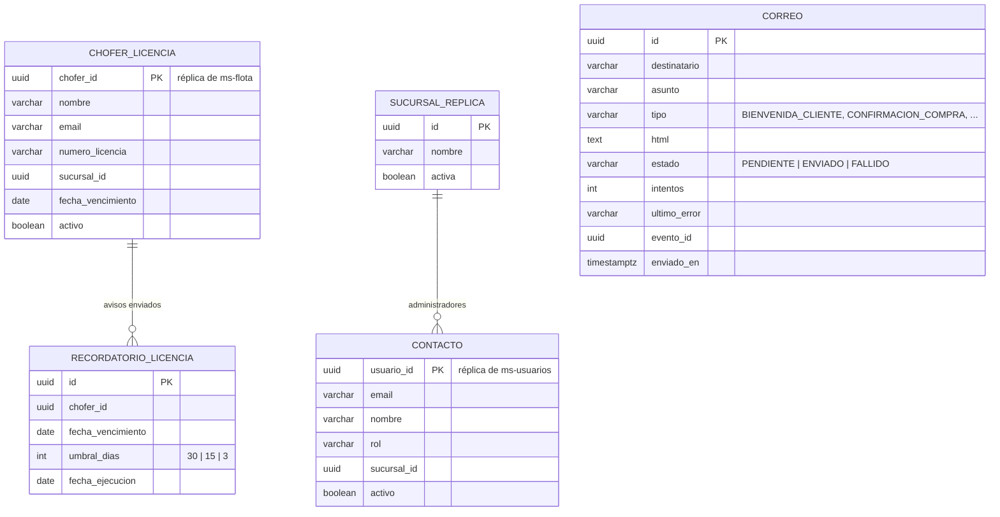
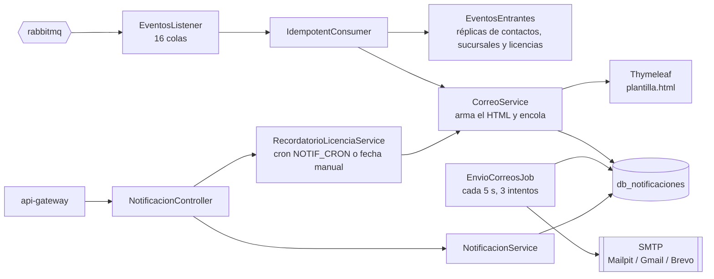

# Manual técnico — ms-notificaciones

| | |
|---|---|
| **Puerto** | 8086 |
| **Base de datos** | `db_notificaciones` |
| **Paquete** | `gt.rutagt.notificaciones` |
| **Swagger** | http://localhost:8080/swagger-ui.html → *ms-notificaciones* |
| **Módulo del enunciado** | Módulo adicional detectado: correos "donde se considere oportuno" y avisos de licencias por vencer |

## 1. Propósito

Envía **todos** los correos del sistema. Ningún otro servicio usa SMTP: publican eventos, y este servicio los convierte en correos con una plantilla HTML de la marca (Thymeleaf, `templates/email/plantilla.html`).

- **Cola y bitácora:** cada correo se guarda primero como `PENDIENTE`; un *job* lo envía y lo marca `ENVIADO` o, tras 3 intentos fallidos, `FALLIDO`. El administrador del sistema ve la bitácora y puede reintentar.
- **Recordatorios de licencias:** avisa al chofer y a los administradores de su sucursal cuando a la licencia le quedan 30, 15 o 3 días. Se ejecuta a diario (cron `NOTIF_CRON`) o manualmente con una **fecha a elección** (requisito de fechas manuales para la calificación).

**Por qué separado** ([ADR-0001](../adr/0001-microservicios-y-eventos.md)): si el servidor de correo está lento o caído, una compra no falla ni se demora; el correo espera en la cola.

## 2. Diagrama de tablas



`UNIQUE (chofer_id, fecha_vencimiento, umbral_dias)` garantiza que un mismo aviso nunca se envíe dos veces. Si el chofer renueva la licencia, la nueva fecha de vencimiento reinicia los avisos.

## 3. Diagrama de componentes



## 4. Diagrama de despliegue

```mermaid
flowchart LR
  GW[api-gateway :8080] -->|lb://ms-notificaciones| SVC[[ms-notificaciones :8086<br/>eclipse-temurin:21-jre · 420 MB]]
  SVC -->|JDBC| PG[(postgres :5432<br/>db_notificaciones)]
  SVC <-->|AMQP| MQ{{rabbitmq :5672}}
  SVC -. registro .-> EU[discovery-server :8761]
  SVC -->|SMTP 1025 / 587| SMTP[[mailpit (dev) · Gmail o Brevo (prod)]]
```

- Imagen `rutagt/ms-notificaciones:1.0.0` construida con `backend/Dockerfile` (`--build-arg SERVICIO=ms-notificaciones`).
- *Healthcheck*: `GET /actuator/health`. El contenedor no publica puertos al host: solo el gateway lo alcanza por la red interna de Docker.
- Al arrancar, Flyway aplica `V1_0__infraestructura_eventos.sql` (outbox e idempotencia, de common-lib) y la migración propia del servicio.

## 5. Endpoints

Bitácora de correos y reintento: solo `ADMIN_SISTEMA`. Ejecutar recordatorios y consultar licencias: `ADMIN_SISTEMA` y `ADMIN_SUCURSAL`.

| Grupo | Método | Ruta | Descripción |
|---|---|---|---|
| Notificaciones | `GET` | `/api/notificaciones/correos` | Bitácora de correos enviados, pendientes y fallidos |
| Notificaciones | `GET` | `/api/notificaciones/correos/{id}/html` | Vista previa HTML de un correo |
| Notificaciones | `POST` | `/api/notificaciones/correos/{id}/reintentar` | Reintentar el envío de un correo fallido |
| Notificaciones | `GET` | `/api/notificaciones/licencias` | Licencias de choferes y recordatorios enviados |
| Notificaciones | `POST` | `/api/notificaciones/recordatorios/ejecutar` | Ejecutar los recordatorios de licencia con una fecha manual |

## 6. Eventos consumidos

ms-notificaciones **no publica** eventos.

| Evento | Productor | Qué hace |
|---|---|---|
| `SucursalGuardada` | ms-usuarios | Actualiza la réplica de sucursales |
| `UsuarioPersonalCreado` | ms-usuarios | Guarda el contacto y envía la bienvenida con la contraseña temporal (`BIENVENIDA_PERSONAL`) |
| `UsuarioClienteRegistrado` | ms-usuarios | Guarda el contacto y envía la bienvenida (`BIENVENIDA_CLIENTE`) |
| `PerfilActualizado` | ms-usuarios | Actualiza nombre y correo del contacto |
| `UsuarioEstadoCambiado` | ms-usuarios | Activa o desactiva el contacto (los inactivos no reciben avisos) |
| `ChoferGuardado` | ms-flota | Actualiza la licencia; si ya está dentro de un umbral, avisa de inmediato |
| `ViajeProgramado` | ms-viajes | Avisa al chofer de su viaje (`VIAJE_ASIGNADO`) |
| `ViajeEliminado` | ms-viajes | Avisa a los compradores que el viaje se canceló (`VIAJE_CANCELADO`) |
| `BoletosVendidos` | ms-viajes | Confirmación de compra con asientos y códigos de boleto (`CONFIRMACION_COMPRA`) |
| `AlquilerAsignado` | ms-viajes | Avisa al cliente y al chofer (`ALQUILER_ASIGNADO`, `ALQUILER_ASIGNADO_CHOFER`) |
| `CarteraRecargada` | ms-clientes | `RECARGA_CARTERA` |
| `CarteraReembolsada` | ms-clientes | `REEMBOLSO_CARTERA` |
| `AlquilerSolicitado` | ms-clientes | Acuse al cliente (`ALQUILER_RECIBIDO`) y aviso a los administradores de la sucursal (`ALQUILER_SOLICITADO`) |
| `AlquilerPrecioConfirmado` | ms-clientes | Avisa al cliente que ya puede pagar (`ALQUILER_PRECIO`) |
| `AlquilerRechazado` | ms-clientes | `ALQUILER_RECHAZADO` |
| `AlquilerPagado` | ms-clientes | `ALQUILER_PAGADO` |

Cada cola es `ms-notificaciones.<routing-key>` con su DLQ `…​.dlq`.

## 7. Llamadas síncronas

Ninguna.

## 8. Reglas de negocio

- **Correos siempre asíncronos:** se encolan en la misma transacción que procesa el evento; el envío ocurre después (`EnvioCorreosJob`, cada 5 s).
- **Máximo 3 intentos** por correo; después queda `FALLIDO` con el último error visible en la bitácora. El reintento manual vuelve a ponerlo `PENDIENTE` (no se puede reintentar uno `ENVIADO`: `YA_ENVIADO`).
- **Umbral aplicable de licencia:** el menor umbral (30, 15 o 3) que sea mayor o igual a los días restantes; con 14 días aplica el de 15. Si ese umbral ya se avisó para esa fecha de vencimiento, no se repite. Así, aunque el job no corra algún día, nunca se pierde un aviso ni se duplica.
- **Fecha manual:** `POST /api/notificaciones/recordatorios/ejecutar?fecha=AAAA-MM-DD` ejecuta el proceso como si hoy fuera esa fecha.
- **Idempotencia:** un evento repetido no genera un segundo correo (`processed_event`).

## 9. Variables de entorno

| Variable | Uso | Valor por defecto |
|---|---|---|
| `DB_HOST`, `DB_PORT`, `DB_USER`, `DB_PASSWORD` | Conexión a PostgreSQL | `localhost`, `5432`, `rutagt`, `rutagt` |
| `RABBITMQ_HOST`, `RABBITMQ_PORT`, `RABBITMQ_USER`, `RABBITMQ_PASSWORD` | Conexión a RabbitMQ | `localhost`, `5672`, `rutagt`, `rutagt` |
| `EUREKA_URL` | Registro en Eureka | `http://localhost:8761/eureka` |
| `JWT_SECRET` | Validación del token (mismo valor en todos los servicios) | — (obligatoria) |
| `JAVA_OPTS` | Memoria de la JVM en Docker | `-Xms96m -Xmx256m …` |
| `MAIL_HOST`, `MAIL_PORT` | Servidor SMTP | `localhost`, `1025` (Mailpit) |
| `MAIL_HOST_EN_DOCKER` | Host SMTP que usa el contenedor en `docker-compose.yml` | `mailpit` |
| `MAIL_USERNAME`, `MAIL_PASSWORD` | Credenciales SMTP (contraseña de aplicación de Gmail o clave de Brevo, ver GUIA §10.4) | vacías |
| `MAIL_SMTP_AUTH`, `MAIL_STARTTLS` | `true` en producción | `false` |
| `MAIL_FROM` | Remitente | `RutaGT <no-reply@rutagt.local>` |
| `NOTIF_CRON` | Hora del recordatorio diario (cron de Spring, 6 campos) | `0 0 7 * * *` (07:00) |
| `FRONTEND_URL` | Enlaces dentro de los correos | `http://localhost:4200` |

## 10. Pruebas y cobertura

| Tipo | Clase | Pruebas | Qué cubre |
|---|---|---|---|
| Integración (Testcontainers + `JavaMailSender` simulado) | `NotificacionesIT` | 6 | Bienvenida idempotente, aviso de licencia al chofer y al administrador, aviso inmediato al guardar un chofer, correos de ventas y alquileres, correo fallido y reintento, mensaje inválido que termina en la DLQ |
| Unitarias | `NotificacionesUnitTest` | 3 | Umbral aplicable, formato de montos y roles, armado del mensaje |

Cobertura de líneas (integración): **93.5 %**.
