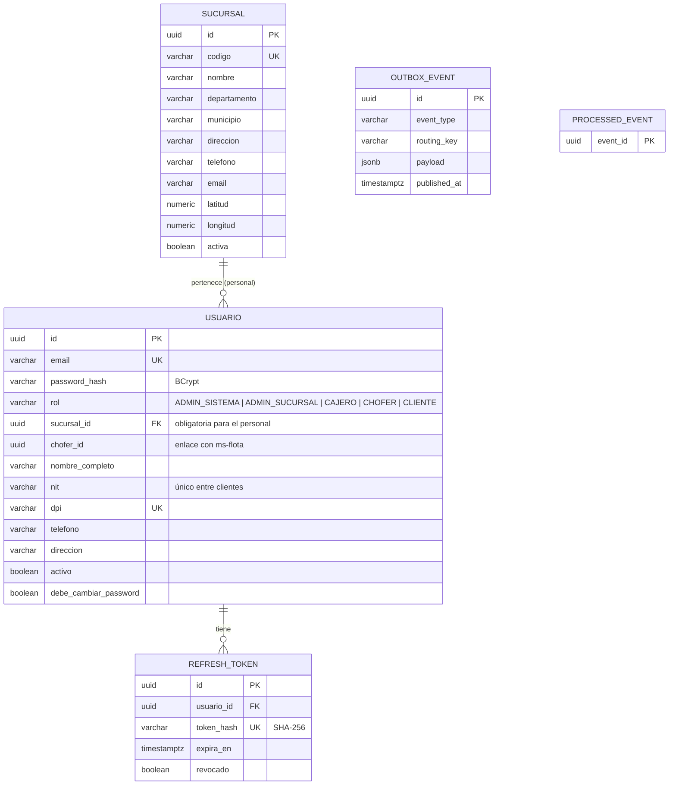
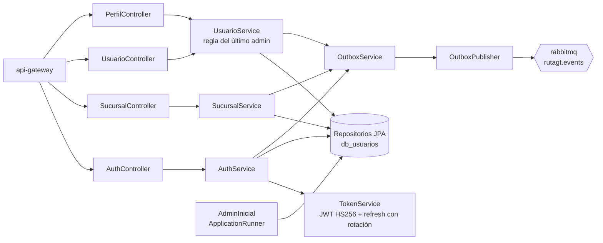
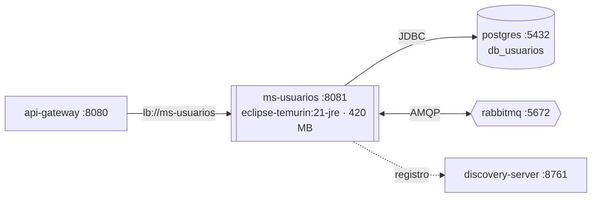

# Manual técnico — ms-usuarios

| | |
|---|---|
| **Puerto** | 8081 |
| **Base de datos** | `db_usuarios` |
| **Paquete** | `gt.rutagt.usuarios` |
| **Swagger** | http://localhost:8080/swagger-ui.html → *ms-usuarios* (o http://localhost:8081/swagger-ui.html) |
| **Módulo del enunciado** | Finanzas y administración (usuarios, roles, sucursales y perfil) |

## 1. Propósito

Es la **fuente de verdad de la identidad**:
- Registra a los clientes, autentica a todos los usuarios y emite el JWT con su rol y sucursal.
- Administra las sucursales y el personal (administradores de sucursal, cajeros y choferes).
- Guarda el perfil de cada usuario (NIT, DPI, teléfono y dirección, obligatorios para todos).

Al arrancar crea el **administrador del sistema** inicial (`AdminInicial`) si no existe ninguno, con `BOOTSTRAP_ADMIN_*`.

## 2. Diagrama de tablas

`OUTBOX_EVENT` y `PROCESSED_EVENT` existen en todos los servicios (common-lib, ver [ADR-0003](../adr/0003-outbox-e-idempotencia.md)).

## 3. Diagrama de componentes

ms-usuarios **no consume** eventos ni llama a otros servicios: solo publica.

## 4. Diagrama de despliegue

- Imagen `rutagt/ms-usuarios:1.0.0` construida con `backend/Dockerfile` (`--build-arg SERVICIO=ms-usuarios`).
- *Healthcheck*: `GET /actuator/health`. El contenedor no publica puertos al host: solo el gateway lo alcanza por la red interna de Docker.
- Al arrancar, Flyway aplica `V1_0__infraestructura_eventos.sql` (outbox e idempotencia, de common-lib) y la migración propia del servicio.

## 5. Endpoints

Todas las rutas pasan por el gateway (`http://localhost:8080`). Públicas: `/api/auth/**` y `GET /api/sucursales/**`. El resto requiere `Authorization: Bearer <token>`.

| Grupo | Método | Ruta | Descripción |
|---|---|---|---|
| Autenticación | `POST` | `/api/auth/cambiar-password` | Cambiar mi contraseña |
| Autenticación | `POST` | `/api/auth/login` | Iniciar sesión |
| Autenticación | `POST` | `/api/auth/logout` | Cerrar sesión |
| Autenticación | `POST` | `/api/auth/refresh` | Renovar el token de acceso |
| Autenticación | `POST` | `/api/auth/registro` | Crear cuenta de cliente |
| Perfil | `GET` | `/api/perfil` | Ver mi perfil |
| Perfil | `PUT` | `/api/perfil` | Modificar mi perfil |
| Sucursales | `GET` | `/api/sucursales` | Listar sucursales |
| Sucursales | `POST` | `/api/sucursales` | Crear sucursal |
| Sucursales | `GET` | `/api/sucursales/{id}` | Ver una sucursal |
| Sucursales | `PUT` | `/api/sucursales/{id}` | Modificar sucursal |
| Sucursales | `PATCH` | `/api/sucursales/{id}/estado` | Activar o desactivar sucursal |
| Usuarios del personal | `GET` | `/api/usuarios` | Listar personal |
| Usuarios del personal | `POST` | `/api/usuarios` | Crear usuario del personal |
| Usuarios del personal | `GET` | `/api/usuarios/{id}` | Ver usuario |
| Usuarios del personal | `PATCH` | `/api/usuarios/{id}/estado` | Activar o desactivar usuario |

Errores: siempre `ProblemDetail` (RFC 7807) con `codigo` y, en validaciones, `errores` por campo.

## 6. Eventos publicados

| Evento | Routing key | Cuándo | Consumidores |
|---|---|---|---|
| `SucursalGuardada` | `usuarios.sucursal.guardada` | Crear, modificar, activar o desactivar una sucursal | ms-flota, ms-viajes, ms-finanzas, ms-notificaciones |
| `UsuarioPersonalCreado` | `usuarios.personal.creado` | Alta de administrador de sucursal, cajero o chofer | ms-notificaciones (bienvenida con contraseña temporal) |
| `UsuarioClienteRegistrado` | `usuarios.cliente.registrado` | Registro público de un cliente | ms-clientes (crea o enlaza por NIT), ms-notificaciones |
| `PerfilActualizado` | `usuarios.perfil.actualizado` | Cambio de datos del perfil | ms-clientes, ms-notificaciones |
| `UsuarioEstadoCambiado` | `usuarios.usuario.estado` | Activar o desactivar un usuario | ms-notificaciones |

## 7. Llamadas síncronas

Ninguna (ni entrantes ni salientes).

## 8. Reglas de negocio

| Regla | Código de error |
|---|---|
| Correo, DPI y código de sucursal únicos | `EMAIL_EN_USO`, `DPI_EN_USO`, `CODIGO_EN_USO` (409) |
| Un NIT pertenece a una sola cuenta de cliente; los clientes no pueden usar CF | `NIT_EN_USO` (409), `NIT_REQUERIDO` |
| El personal siempre pertenece a una sucursal activa (también `CHECK` en la base) | `SUCURSAL_REQUERIDA`, `SUCURSAL_INACTIVA` |
| Un usuario chofer debe indicar a qué chofer de ms-flota corresponde | `CHOFER_REQUERIDO` |
| Los clientes solo se crean desde el registro público | `ROL_INVALIDO` |
| Un administrador de sucursal solo gestiona cajeros y choferes de **su** sucursal | `OTRA_SUCURSAL` (403) |
| No se puede desactivar al **último administrador activo** del sistema ni de una sucursal. Se bloquea la fila con `SELECT … FOR UPDATE` para que dos desactivaciones simultáneas no dejen el sistema sin administrador | `ULTIMO_ADMIN_SISTEMA`, `ULTIMO_ADMIN_SUCURSAL` |
| Usuarios y sucursales no se borran: se desactivan (borrado lógico) | — |
| El personal nuevo recibe una contraseña temporal y debe cambiarla al primer ingreso (`debe_cambiar_password`) | `PASSWORD_INCORRECTA`, `PASSWORD_REPETIDA` |
| Un usuario desactivado no puede iniciar sesión ni refrescar su token | `USUARIO_INACTIVO` (403) |
| El refresh token se guarda como *hash* y se **rota** en cada uso; uno revocado o vencido ya no sirve | 401 |

## 9. Variables de entorno

| Variable | Uso | Valor por defecto |
|---|---|---|
| `DB_HOST`, `DB_PORT`, `DB_USER`, `DB_PASSWORD` | Conexión a PostgreSQL | `localhost`, `5432`, `rutagt`, `rutagt` |
| `RABBITMQ_HOST`, `RABBITMQ_PORT`, `RABBITMQ_USER`, `RABBITMQ_PASSWORD` | Conexión a RabbitMQ | `localhost`, `5672`, `rutagt`, `rutagt` |
| `EUREKA_URL` | Registro en Eureka | `http://localhost:8761/eureka` |
| `JWT_SECRET` | Validación del token (mismo valor en todos los servicios) | — (obligatoria) |
| `JAVA_OPTS` | Memoria de la JVM en Docker | `-Xms96m -Xmx256m …` |
| `JWT_ACCESS_MINUTES` | Duración del access token | `60` |
| `JWT_REFRESH_DAYS` | Duración del refresh token | `7` |
| `BOOTSTRAP_ADMIN_EMAIL`, `BOOTSTRAP_ADMIN_PASSWORD`, `BOOTSTRAP_ADMIN_NOMBRE` | Administrador inicial | `admin@rutagt.com`, `Admin12345`, `Administrador del Sistema` |

## 10. Pruebas y cobertura

| Tipo | Clase | Pruebas | Qué cubre |
|---|---|---|---|
| Integración (Testcontainers: PostgreSQL + RabbitMQ) | `AuthIT` | 7 | Registro (validaciones, duplicados, CF), login, refresh y logout, perfil y cambio de contraseña, 401 sin token |
| Integración | `SucursalUsuarioIT` | 5 | CRUD de sucursales con evento publicado en RabbitMQ, permisos, reglas de administradores, último administrador del sistema, validaciones |
| Unitarias (Mockito) | `UsuariosUnitTest` | 8 | Reglas de `UsuarioService` y `AuthService` sin Spring |

Cobertura de líneas (JaCoCo, pruebas de integración): **92.7 %** (mínimo exigido 60 %). Reporte: `backend/ms-usuarios/target/site/jacoco-it/index.html` después de `./mvnw verify`.
