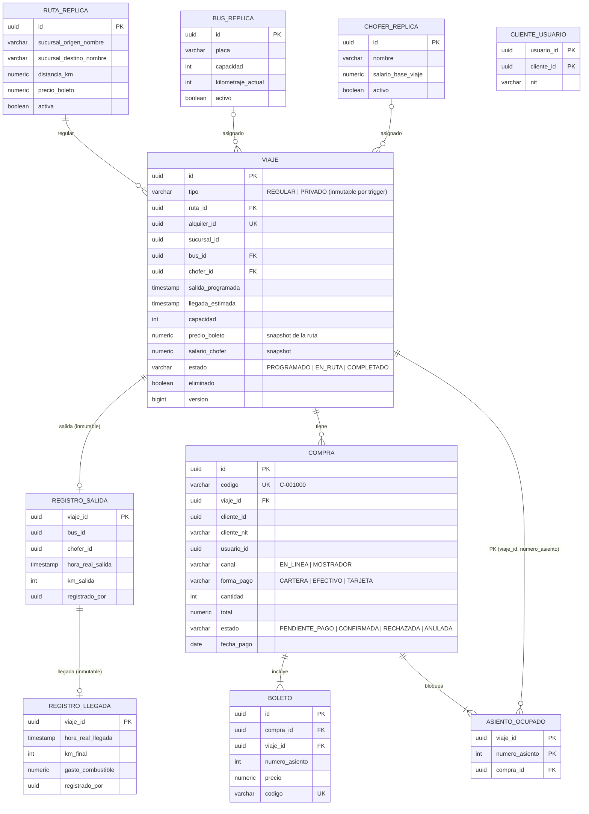
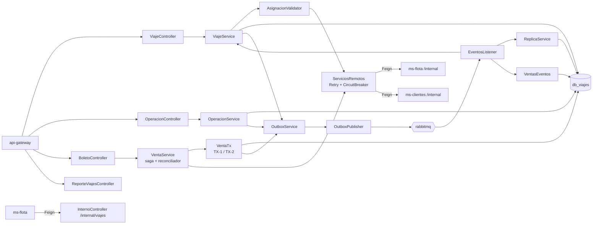
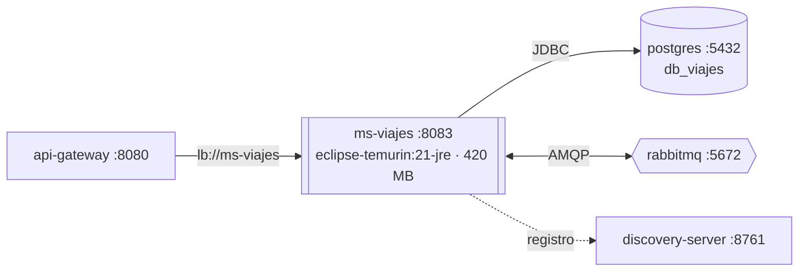

# Manual técnico — ms-viajes

| | |
|---|---|
| **Puerto** | 8083 |
| **Base de datos** | `db_viajes` |
| **Paquete** | `gt.rutagt.viajes` |
| **Swagger** | http://localhost:8080/swagger-ui.html → *ms-viajes* |
| **Módulo del enunciado** | Viajes y ventas (programación, salidas y llegadas, venta en línea y en mostrador, rutas más demandadas, ingresos por boletos) |

## 1. Propósito

Es el **núcleo operativo**:
- Programa viajes **regulares** (sobre una ruta) y ejecuta los viajes **privados** que nacen de un alquiler pagado.
- Registra salidas y llegadas, que son **inmutables**.
- Vende boletos con selección de asientos, en línea (pago con cartera) y en mostrador (efectivo o tarjeta).

**Por qué la venta vive aquí:** el bloqueo de asientos necesita la capacidad y el estado del viaje en la **misma transacción**. Internamente es un módulo separado (`VentaService`, `VentaTx`, `VentasEventos`) que reacciona a los eventos del viaje igual que lo haría un servicio externo, por lo que puede extraerse más adelante.

## 2. Diagrama de tablas

También existe `sucursal_replica`. Tres *triggers* de PostgreSQL protegen los datos aunque haya un error de programación o un acceso directo a la base:
- `trg_tipo_viaje_inmutable`: el tipo de un viaje no cambia.
- `trg_salida_inmutable` y `trg_llegada_inmutable`: rechazan `UPDATE` y `DELETE`.

## 3. Diagrama de componentes

## 4. Diagrama de despliegue

- Imagen `rutagt/ms-viajes:1.0.0` construida con `backend/Dockerfile` (`--build-arg SERVICIO=ms-viajes`).
- *Healthcheck*: `GET /actuator/health`. El contenedor no publica puertos al host: solo el gateway lo alcanza por la red interna de Docker.
- Al arrancar, Flyway aplica `V1_0__infraestructura_eventos.sql` (outbox e idempotencia, de common-lib) y la migración propia del servicio.

## 5. Endpoints

Públicos: `GET /api/viajes/publicos/**` (búsqueda y mapa de asientos). Programación y eliminación: `ADMIN_SUCURSAL`. Salida y llegada: `ADMIN_SUCURSAL` o el `CHOFER` asignado. Mostrador: `ADMIN_SUCURSAL` y `CAJERO`. Compra en línea e historial: `CLIENTE`. Reportes: `ADMIN_SISTEMA` y `ADMIN_SUCURSAL`.

| Grupo | Método | Ruta | Descripción |
|---|---|---|---|
| Boletos | `POST` | `/api/boletos/compras` | Comprar boletos en línea con la cartera digital |
| Boletos | `GET` | `/api/boletos/compras/{id}` | Ver una compra (estado, asientos y códigos de boleto) |
| Boletos | `GET` | `/api/boletos/historial` | Mi historial de boletos |
| Boletos | `POST` | `/api/boletos/mostrador` | Venta presencial en mostrador |
| Boletos | `GET` | `/api/boletos/ventas` | Ventas de un viaje |
| Operación | `GET` | `/api/operacion/pendientes` | Viajes con salida o llegada pendiente |
| Operación | `GET` | `/api/operacion/registros` | Historial de registros (solo lectura) |
| Operación | `POST` | `/api/operacion/viajes/{id}/llegada` | Registrar llegada |
| Operación | `POST` | `/api/operacion/viajes/{id}/salida` | Registrar salida |
| Reportes de viajes | `GET` | `/api/reportes/viajes/ingresos-boletos` | Ingresos por venta de boletos |
| Reportes de viajes | `GET` | `/api/reportes/viajes/rutas-demandadas` | Rutas más demandadas |
| Viajes | `GET` | `/api/viajes` | Listar viajes de la sucursal |
| Viajes | `POST` | `/api/viajes` | Programar viaje regular |
| Viajes | `GET` | `/api/viajes/publicos` | Viajes regulares disponibles (público) |
| Viajes | `GET` | `/api/viajes/publicos/{id}/asientos` | Mapa de asientos de un viaje (público) |
| Viajes | `GET` | `/api/viajes/tablero` | Tablero de la sucursal (KPIs y salidas del día) |
| Viajes | `GET` | `/api/viajes/{id}` | Ver viaje |
| Viajes | `DELETE` | `/api/viajes/{id}` | Eliminar viaje no iniciado |
| Viajes | `PATCH` | `/api/viajes/{id}/asignacion` | Asignar o cambiar bus, chofer y horario |

**API interna** (oculta en Swagger y bloqueada en el gateway): `GET /internal/viajes/activos` y `GET /internal/viajes/existe`, que usa ms-flota.

## 6. Eventos

**Publicados**

| Evento | Routing key | Cuándo | Consumidores |
|---|---|---|---|
| `ViajeProgramado` | `viajes.viaje.programado` | Programar un viaje o asignar bus y chofer a un privado | ms-notificaciones |
| `ViajeIniciado` | `viajes.viaje.iniciado` | Registrar la salida | ms-flota |
| `ViajeFinalizado` | `viajes.viaje.finalizado` | Registrar la llegada (km, combustible, salario) | ms-flota, ms-finanzas, ms-clientes |
| `ViajeEliminado` | `viajes.viaje.eliminado` | Eliminar un viaje programado (incluye las compras) | ms-viajes (módulo de ventas), ms-clientes, ms-finanzas, ms-notificaciones |
| `BoletosVendidos` | `viajes.boletos.vendidos` | Compra confirmada (en línea o mostrador) | ms-finanzas, ms-notificaciones |
| `AlquilerAsignado` | `viajes.alquiler.asignado` | Asignar bus y chofer a un viaje privado | ms-clientes, ms-notificaciones |

**Consumidos**

| Evento | Productor | Qué hace |
|---|---|---|
| `SucursalGuardada` | ms-usuarios | Réplica de sucursales |
| `BusGuardado`, `ChoferGuardado`, `RutaGuardada` | ms-flota | Réplicas para listar viajes, búsqueda pública y reportes sin llamar a ms-flota |
| `ClienteVinculado` | ms-clientes | Enlaza el usuario con el cliente de su NIT (`cliente_usuario`) para el historial |
| `AlquilerPagado` | ms-clientes | Crea el viaje **PRIVADO** pendiente de asignar bus y chofer |
| `ViajeEliminado` | ms-viajes | El módulo de ventas anula las compras y libera los asientos |

## 7. Llamadas síncronas

| # | Hacia | Endpoint | Por qué debe ser síncrona |
|---|---|---|---|
| S1 | ms-flota | `GET /internal/buses/{id}/validar-asignacion` | Saber **ya** si el bus está activo, no en taller y con capacidad |
| S2 | ms-flota | `GET /internal/choferes/{id}/validar-asignacion` | Licencia vigente en la fecha del viaje |
| S3 | ms-clientes | `POST /internal/cartera/debitos` (`Idempotency-Key`) | La compra en línea solo se confirma si el débito se aplicó |
| S4 | ms-clientes | `GET /internal/cartera/debitos/{referencia}` | El reconciliador cierra compras sin respuesta |
| S5 | ms-clientes | `POST /internal/clientes/resolver` | La venta en mostrador necesita el `clienteId` del NIT |

Resiliencia (Resilience4j): *timeout* de conexión 2 s y de lectura 3 s, 3 reintentos solo ante errores de red, circuit breaker (50 % de fallos en las últimas 10 llamadas → abierto 15 s). Con el circuito abierto se responde 503 de inmediato.

## 8. Reglas de negocio

**Programación**
- Solo se programan viajes en rutas **activas** que salen de la sucursal del administrador (`NO_ES_ORIGEN`, `RUTA_INACTIVA`).
- La llegada estimada debe ser posterior a la salida (`HORARIO_INVALIDO`, también `CHECK` en la base).
- Un bus o chofer no puede tener dos viajes con horarios traslapados (`BUS_OCUPADO`, `CHOFER_OCUPADO`).
- Precio del boleto y salario del chofer se copian al viaje (*snapshot*): cambiar la ruta después no altera viajes ya programados.
- Si se cambia el bus, los asientos vendidos deben existir en el nuevo (`ASIENTOS_FUERA_DE_CAPACIDAD`).
- Solo se elimina un viaje `PROGRAMADO` (`VIAJE_INICIADO`) → [ADR-0005](../adr/0005-eliminacion-de-viajes-por-eventos.md).

**Operación**
- Salida: el viaje debe estar `PROGRAMADO`, con bus y chofer, y el km de salida no puede ser menor al del bus (`VIAJE_NO_PROGRAMADO`, `SIN_ASIGNACION`, `KM_MENOR`).
- Llegada: requiere salida, km final mayor al de salida y hora posterior (`SIN_SALIDA`, `KM_FINAL_INVALIDO`, `HORA_LLEGADA_INVALIDA`).
- Un chofer solo registra **sus** viajes (`NO_ES_SU_VIAJE`, `SIN_CHOFER`).
- Una vez registradas, salida y llegada **no se modifican ni se eliminan** (`SALIDA_YA_REGISTRADA`, `LLEGADA_YA_REGISTRADA`, *triggers*). La interfaz pide confirmación con una casilla "entiendo que no podrá modificarse".
- Fecha y hora reales se ingresan manualmente (con la fecha actual por defecto).

**Venta** ([ADR-0004](../adr/0004-bloqueo-de-asientos-y-saga.md))
- Saga orquestada: compra `PENDIENTE_PAGO` + bloqueo de asientos → débito idempotente → `CONFIRMADA` o compensación (`RECHAZADA` y asientos liberados). Sin respuesta → 202 y reconciliador cada 30 s.
- Dos compras del mismo asiento: solo una gana (`ASIENTOS_OCUPADOS`, 409). También `ASIENTOS_REPETIDOS` y `ASIENTO_INEXISTENTE`.
- No se venden boletos de viajes que ya salieron ni de viajes privados (`VIAJE_NO_DISPONIBLE`, `VIAJE_PRIVADO`).
- Mostrador: efectivo o tarjeta, cliente por NIT o consumidor final (CF).
- Historial del cliente: compras en línea **y** de mostrador de todos los clientes enlazados a su usuario por NIT ([ADR-0007](../adr/0007-clientes-por-nit.md)).
- Un cliente solo ve sus compras (`NO_ES_SU_COMPRA`).

**Alquiler**
- Un viaje privado se crea al recibir `AlquilerPagado`. Al asignarle bus y chofer se publica `AlquilerAsignado`; el chofer cobra su salario base + 15 %.

## 9. Variables de entorno

| Variable | Uso | Valor por defecto |
|---|---|---|
| `DB_HOST`, `DB_PORT`, `DB_USER`, `DB_PASSWORD` | Conexión a PostgreSQL | `localhost`, `5432`, `rutagt`, `rutagt` |
| `RABBITMQ_HOST`, `RABBITMQ_PORT`, `RABBITMQ_USER`, `RABBITMQ_PASSWORD` | Conexión a RabbitMQ | `localhost`, `5672`, `rutagt`, `rutagt` |
| `EUREKA_URL` | Registro en Eureka | `http://localhost:8761/eureka` |
| `JWT_SECRET` | Validación del token (mismo valor en todos los servicios) | — (obligatoria) |
| `JAVA_OPTS` | Memoria de la JVM en Docker | `-Xms96m -Xmx256m …` |

Propiedad interna: `rutagt.ventas.reconciliacion-ms` (intervalo del reconciliador, 30000 ms).

## 10. Pruebas y cobertura

| Tipo | Clase | Pruebas | Qué cubre |
|---|---|---|---|
| Integración (Testcontainers; `FlotaClient` y `ClientesClient` simulados) | `ViajesIT` | 10 | Programar y detectar traslapes; bloqueo de asientos; **10 compras simultáneas del mismo asiento: solo una gana**; saldo insuficiente que libera asientos y pago sin respuesta que queda pendiente; mostrador e historial enlazado por NIT; salida y llegada inmutables; eliminación con propagación; alquiler pagado → viaje privado con +15 %; reportes; réplicas por eventos |
| Unitarias | `ViajesUnitTest` | 3 | Descripción de viajes, tipo sin *setter*, asignación completa |

Cobertura de líneas (integración): **95.3 %**.
